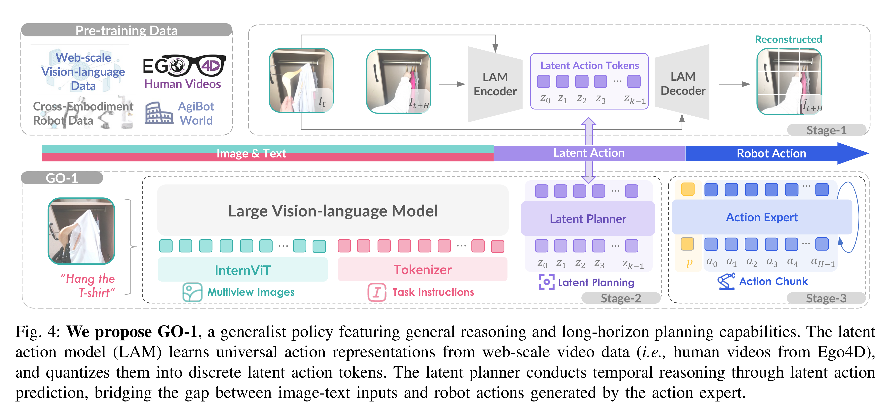
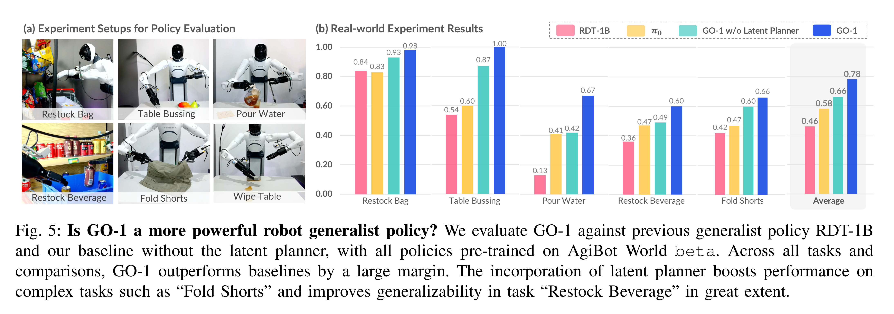

# AgiBot World Colosseo: A Large-scale Manipulation Platform for Scalable and Intelligent Embodied Systems

[Official source](https://arxiv.org/abs/2503.06669)

## Abstract—

We explore how scalable robot data can address real-world challenges for generalized robotic manipulation. In- troducing AgiBot World, a large-scale platform comprising over 1 million trajectories across 217 tasks in five deployment sce- narios, we achieve an order-of-magnitude increase in data scale compared to existing datasets. Accelerated by a standardized collection pipeline with human-in-the-loop verification, AgiBot World guarantees high-quality and diverse data distribution. It is extensible from grippers to dexterous hands and visuo-tactile sensors for fine-grained skill acquisition. Building on top of data, we introduce Genie Operator-1 (GO-1), a novel generalist policy that leverages latent action representations to maximize data utilization, demonstrating predictable performance scaling with increased data volume. Policies pre-trained on our dataset achieve an average performance improvement of 30% over those trained on Open X-Embodiment, both in in-domain and out-of-distribution scenarios. GO-1 exhibits exceptional capabil- ity in real-world dexterous and long-horizon tasks, achieving over 60% success rate on complex tasks and outperforming prior RDT approach by 32%. By open-sourcing the dataset, tools, and models, we aim to democratize access to large-scale, high-quality robot data, advancing the pursuit of scalable and general-purpose intelligence.

Fig. 4: We propose GO-1, a generalist policy featuring general reasoning and long-horizon planning capabilities. The latent action model (LAM) learns universal action representations from web-scale video data (i.e., human videos from Ego4D), and quantizes them into discrete latent action tokens. The latent planner conducts temporal reasoning through latent action prediction, bridging the gap between image-text inputs and robot actions generated by the action expert.

p. 6

Fig. 5: Is GO-1 a more powerful robot generalist policy? We evaluate GO-1 against previous generalist policy RDT-1B and our baseline without the latent planner, with all policies pre-trained on AgiBot World beta. Across all tasks and comparisons, GO-1 outperforms baselines by a large margin. The incorporation of latent planner boosts performance on complex tasks such as “Fold Shorts” and improves generalizability in task “Restock Beverage” in great extent.

p. 7
