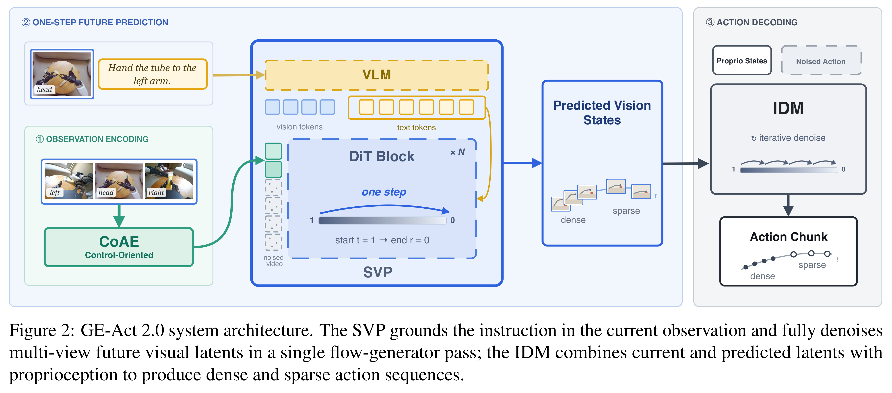
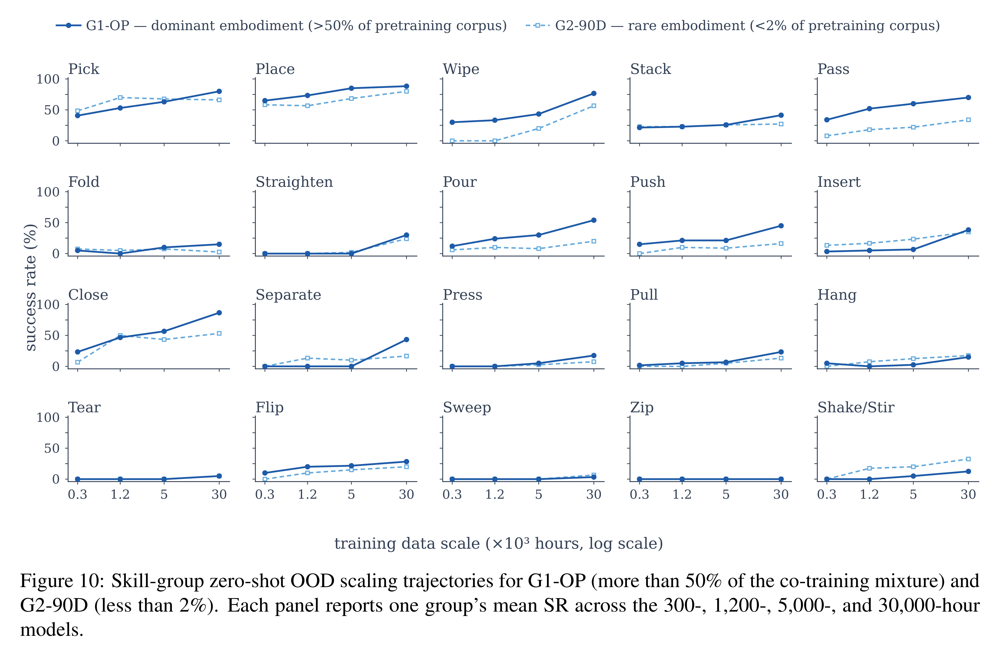

# GE-Act 2.0: Pretraining and Scaling a World-Action Model for Robotic Manipulation

[Official source](https://arxiv.org/abs/2609.05588)

## Abstract

World–action models predict future states to guide robot actions, enabling learning from both action-free video and action-labeled interaction. Yet most inherit pretrained video generators, leaving pretraining and scaling of world–action models underexplored. We introduce Genie Envisioner Act 2.0 (GE-Act 2.0), a world–action model in which every trainable generative and action component is initialized from scratch on manipulation data. GE-Act 2.0 combines a control-oriented autoencoder (CoAE), a single-step visual planner (SVP), and an inverse dynamics model (IDM). CoAE retains action- and instruction-relevant information under aggressive compression, while SVP produces a completed future state in one differentiable pass, allowing visual planning and inverse dynamics to be pretrained separately on complementary data. These components are then jointly trained using knowledge-aligned selective optimization (KASO), which reduces mismatched supervision by selecting only predicted future states judged behaviorally compatible with the recorded action. We evaluate pretrained checkpoints directly, without per-task fine-tuning, on 100 tasks across 20 manipulation skill groups, with held-out scenes, backgrounds, lighting conditions, and object instances. Scaling co-training data from 300 to 30,000 hours raises success from 17.1% to 44.1% on G1-OP and from 13.4% to 31.1% on G2-90D. Despite comprising less than 2% of the co-training data, G2-90D improves by 17.7 points, suggesting useful cross-embodiment transfer from the broader corpus. The gains span 19/20 and 18/20 skill groups, respectively, and skill-specific coverage strongly correlates with zero-shot out-of-distribution (OOD) success (Pearson r = 0.80; Spearman ρ = 0.85). Under the same zero-shot OOD protocol, the model grounds object, color, shape, and position references in at least 90% of trials; qualitative stress tests further show that it follows explicit instructions even when they conflict with an already-committed behavior or a conventional scene association.

Figure 2: GE-Act 2.0 system architecture. The SVP grounds the instruction in the current observation and fully denoises multi-view future visual latents in a single flow-generator pass; the IDM combines current and predicted latents with proprioception to produce dense and sparse action sequences.

p. 5

Figure 10: Skill-group zero-shot OOD scaling trajectories for G1-OP (more than 50% of the co-training mixture) and G2-90D (less than 2%). Each panel reports one group’s mean SR across the 300-, 1,200-, 5,000-, and 30,000-hour models.

p. 18
