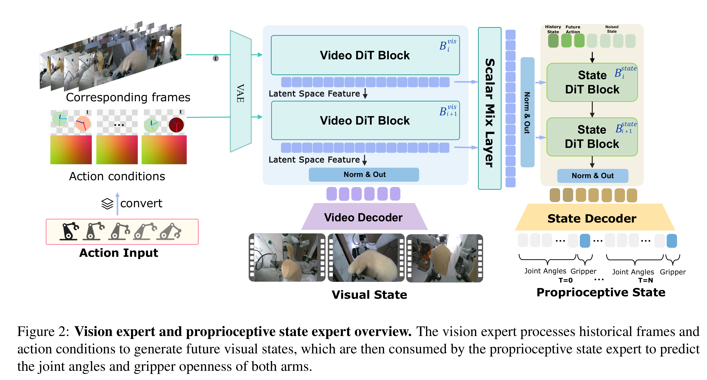
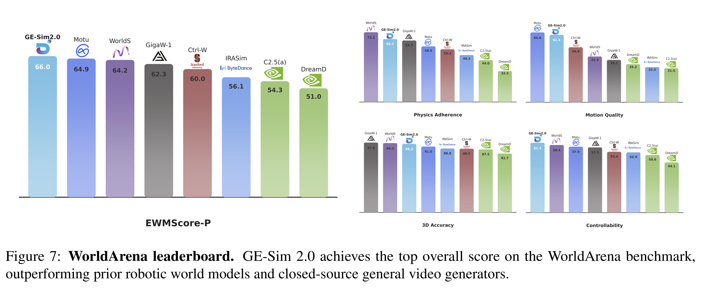
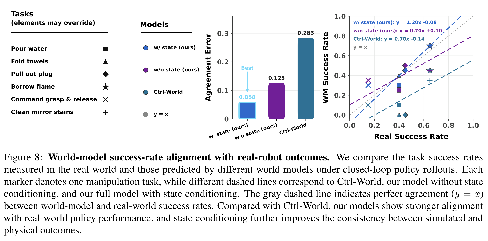

# GE-Sim 2.0: A Roadmap Towards Comprehensive Closed-loop Video World Simulators for Robotic Manipulation

[Official source](https://arxiv.org/abs/2605.27491)

## Abstract

We introduce GE-Sim 2.0 (Genie Envisioner World Simulator 2.0), a closed-loop video world simulator for robotic manipulation. Building on the action-conditioned video generation framework of Genie Envisioner, GE-Sim 2.0 is re-trained on thousands of hours of real-world robot data spanning teleoperation, contact-rich interaction, and on-robot policy deployment, substantially improving action-following fidelity and trajectory coverage. On top of this foundation, three new modules close the loop from video simulation to policy learning: a state expert that decodes proprioceptive state from video latents to support next-chunk prediction by downstream policy models; a world judge that scores generated rollouts against task instructions, yielding machine-verifiable success signals and rewards in place of manual inspection; and an acceleration framework that delivers a 25-frame rollout in 2.3 seconds on a single H100, with up to 4× frame skipping at inference for long-horizon evaluation. GE-Sim 2.0 tops the public WorldArena leaderboard at only 2B parameters, outperforming both dedicated robotic world models and closed-source general video generators, and policies trained against its rollouts and rewards translate into measurable real-world gains, establishing GE-Sim 2.0 as a practical platform for scalable evaluation and closed-loop learning of manipulation policies.

Figure 2: Vision expert and proprioceptive state expert overview. The vision expert processes historical frames and action conditions to generate future visual states, which are then consumed by the proprioceptive state expert to predict the joint angles and gripper openness of both arms.

p. 5

Figure 7: WorldArena leaderboard. GE-Sim 2.0 achieves the top overall score on the WorldArena benchmark, outperforming prior robotic world models and closed-source general video generators.

p. 13

Figure 8: World-model success-rate alignment with real-robot outcomes. We compare the task success rates measured in the real world and those predicted by different world models under closed-loop policy rollouts. Each marker denotes one manipulation task, while different dashed lines correspond to Ctrl-World, our model without state conditioning, and our full model with state conditioning. The gray dashed line indicates perfect agreement (y = x) between world-model and real-world success rates. Compared with Ctrl-World, our models show stronger alignment with real-world policy performance, and state conditioning further improves the consistency between simulated and physical outcomes.

p. 14
