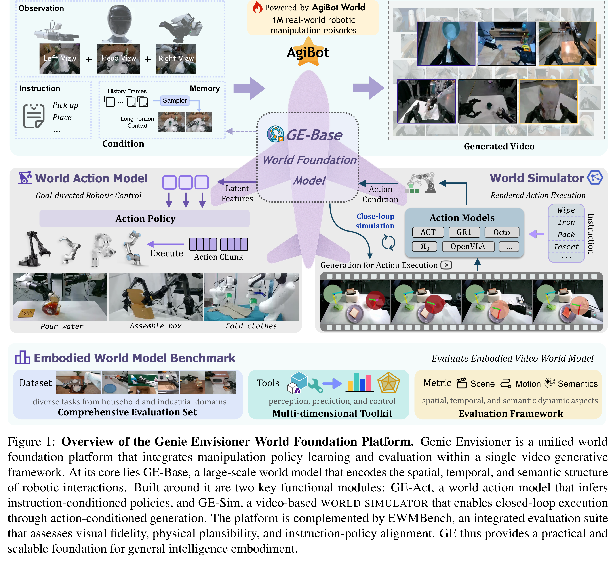
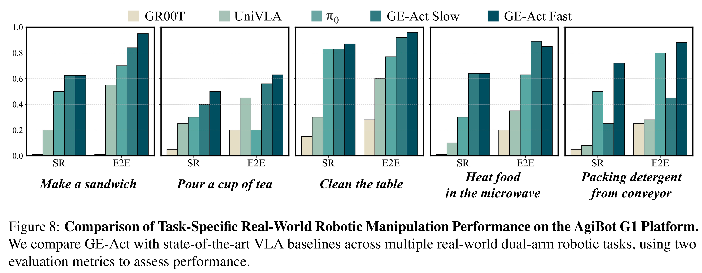

# Genie Envisioner: A Unified World Foundation Platform for Robotic Manipulation

[Official source](https://arxiv.org/abs/2508.05635)

## Abstract

We introduce Genie Envisioner (GE), a unified world foundation platform for robotic manipulation that integrates policy learning, evaluation, and simulation within a single video-generative framework. At its core, GE-Base is a large-scale, instruction-conditioned video diffusion model that captures the spatial, temporal, and semantic dynamics of real-world robotic interactions in a structured latent space. Built upon this foundation, GE-Act maps latent representations to executable action trajectories through a lightweight, flow-matching decoder, enabling precise and generalizable policy inference across diverse embodiments with minimal supervision. To support scalable evaluation and training, GE-Sim serves as an action-conditioned neural simulator, producing high-fidelity rollouts for closed-loop policy development. The platform is further equipped with EWMBench, a standardized benchmark suite measuring visual fidelity, physical consistency, and instruction-action alignment. Together, these components establish Genie Envisioner as a scalable and practical foundation for instruction-driven, general-purpose embodied intelligence. All code, models, and benchmarks will be released publicly.

Figure 1: Overview of the Genie Envisioner World Foundation Platform. Genie Envisioner is a unified world foundation platform that integrates manipulation policy learning and evaluation within a single video-generative framework. At its core lies GE-Base, a large-scale world model that encodes the spatial, temporal, and semantic structure of robotic interactions. Built around it are two key functional modules: GE-Act, a world action model that infers instruction-conditioned policies, and GE-Sim, a video-based WORLD SIMULATOR that enables closed-loop execution through action-conditioned generation. The platform is complemented by EWMBench, an integrated evaluation suite that assesses visual fidelity, physical plausibility, and instruction-policy alignment. GE thus provides a practical and scalable foundation for general intelligence embodiment.

p. 2

Figure 8: Comparison of Task-Specific Real-World Robotic Manipulation Performance on the AgiBot G1 Platform. We compare GE-Act with state-of-the-art VLA baselines across multiple real-world dual-arm robotic tasks, using two evaluation metrics to assess performance.

p. 10
