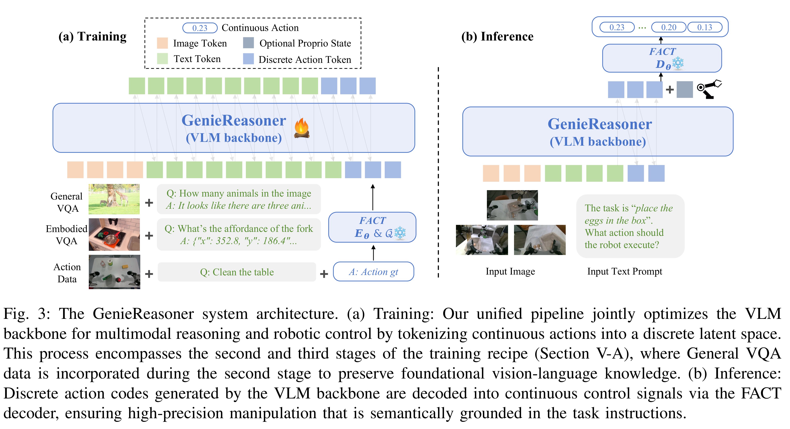
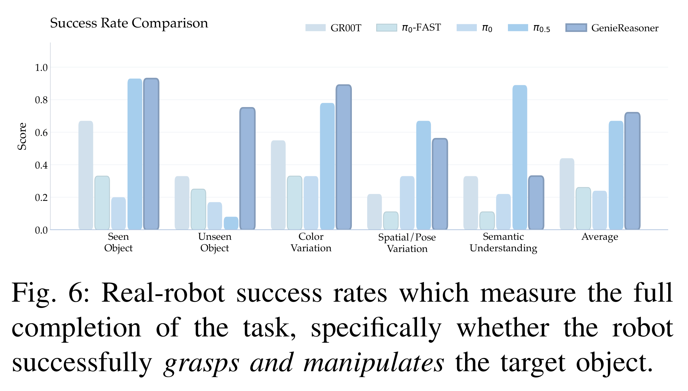

# Unified Embodied VLM Reasoning with Robotic Action via Autoregressive Discretized Pre-training

[Official source](https://arxiv.org/abs/2512.24125)

## Abstract—

General-purpose robotic systems operating in open-world environments must achieve both broad generalization and high-precision action execution, a combination that remains challenging for existing Vision-Language-Action (VLA) models. While large Vision-Language Models (VLMs) improve semantic generalization, insufficient embodied reasoning leads to brittle behavior, and conversely, strong reasoning alone is inadequate without precise control. To provide a decoupled and quantitative assessment of this bottleneck, we introduce Embodied Reasoning Intelligence Quotient (ERIQ), a large-scale embodied reasoning benchmark in robotic manipulation, comprising 6K+ question–answer pairs across four reasoning dimensions. By decoupling reasoning from execution, ERIQ enables systematic evaluation and reveals a strong positive correlation between embodied reasoning capability and end-to-end VLA generalization. To bridge the gap from reasoning to precise execution, we propose FACT, a flow-matching-based action tokenizer that converts continuous control into discrete sequences while preserving high-fidelity trajectory reconstruction. The resulting GenieReasoner jointly optimizes reasoning and action in a unified space, outperforming both continuous-action and prior discrete-action baselines in real-world tasks. Together, ERIQ and FACT provide a principled framework for diagnosing and overcoming the reasoning–precision trade-off, advancing robust, general-purpose robotic manipulation.

Fig. 3: The GenieReasoner system architecture. (a) Training: Our unified pipeline jointly optimizes the VLM backbone for multimodal reasoning and robotic control by tokenizing continuous actions into a discrete latent space. This process encompasses the second and third stages of the training recipe (Section V-A), where General VQA data is incorporated during the second stage to preserve foundational vision-language knowledge. (b) Inference: Discrete action codes generated by the VLM backbone are decoded into continuous control signals via the FACT decoder, ensuring high-precision manipulation that is semantically grounded in the task instructions.

p. 5

Fig. 6: Real-robot success rates which measure the full completion of the task, specifically whether the robot successfully grasps and manipulates the target object.

p. 7
