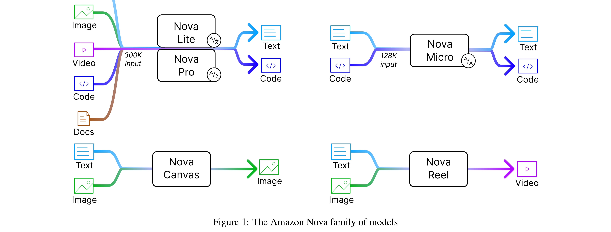

# The Amazon Nova Family of Models: Technical Report and Model Card

[Official source](https://www.amazon.science/publications/the-amazon-nova-family-of-models-technical-report-and-model-card)

## Abstract

We present Amazon Nova, a new generation of state-of-the-art foundation models that deliver frontier intelligence and industry-leading price performance. Amazon Nova Pro is a highly-capable multimodal model with the best combination of accuracy, speed, and cost for a wide range of tasks. Amazon Nova Lite is a low-cost multimodal model that is lightning fast for processing images, video, documents and text. Amazon Nova Micro is a text-only model that delivers our lowest-latency responses at very low cost. Amazon Nova Canvas is an image generation model that creates professional grade images with rich customization controls. Amazon Nova Reel is a video generation model offering high-quality outputs, customization, and motion control. Our models were built responsibly and with a commitment to customer trust, security, and reliability. We report benchmarking results for core capabilities, agentic performance, long context, functional adaptation, runtime performance, and human evaluation.

Figure 1: The Amazon Nova family of models

p. 1
