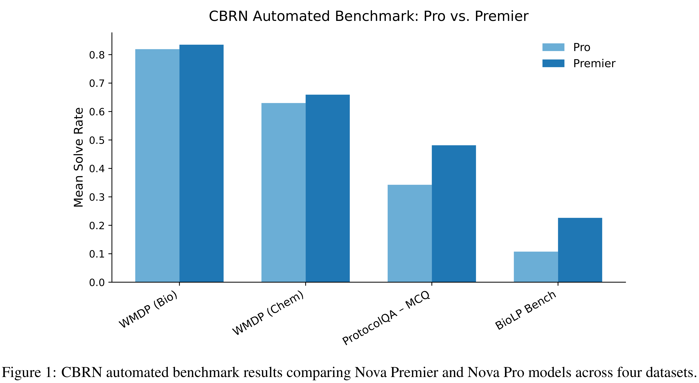

# Evaluating the Critical Risks of Amazon's Nova Premier under the Frontier Model Safety Framework

[Official source](https://arxiv.org/abs/2507.06260)

## Abstract

Nova Premier is Amazon’s most capable multimodal foundation model and teacher for model distillation. It processes text, images, and video with a one-million-token context window, enabling analysis of large codebases, 400-page documents, and 90-minute videos in a single prompt [2]. We present the first comprehensive evaluation of Nova Premier’s critical risk profile under the Frontier Model Safety Framework [1]. Evaluations target three high-risk domains–Chemical, Biological, Radiological & Nuclear (CBRN), Offensive Cyber Operations, and Automated AI R&D–and combine automated benchmarks, expert red-teaming, and uplift studies to determine whether the model exceeds release thresholds. We summarize our methodology and report core findings. Based on this evaluation, we find that Nova Premier is safe for public release as per our commitments made at the 2025 Paris AI Safety Summit. We will continue to enhance our safety evaluation and mitigation pipelines as new risks and capabilities associated with frontier models are identified.

Figure 1: CBRN automated benchmark results comparing Nova Premier and Nova Pro models across four datasets.

p. 3
