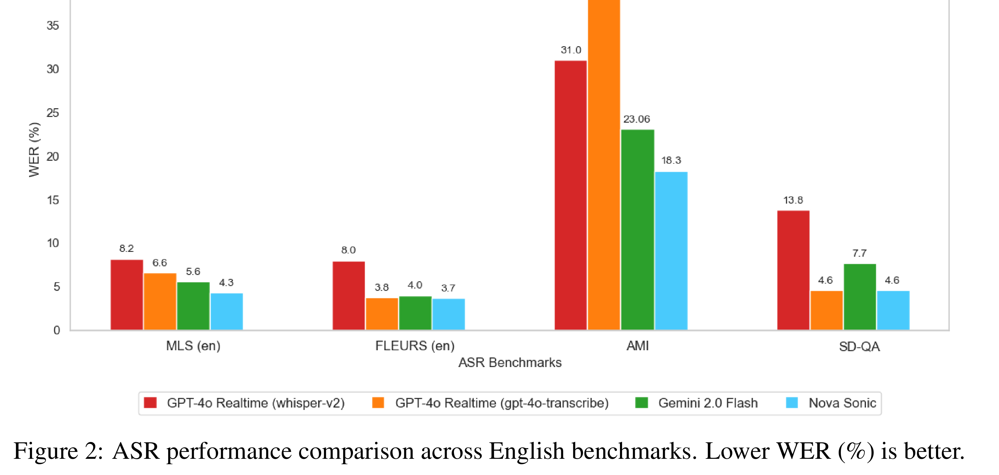

# Amazon Nova Sonic: Technical Report and Model Card

[Official source](https://www.amazon.science/publications/amazon-nova-sonic-technical-report-and-model-card)

## Abstract

We present Amazon Nova Sonic, a new multimodal foundation model that unifies speech and text processing in a single architecture, delivering frontier voice intelligence and industry-leading price performance. Amazon Nova Sonic ("Nova Sonic") builds on the advances in large pre-trained text and speech models, while fusing the two modalities in a unified architecture to power downstream tasks requiring both speech and text, e.g. voice-enabled AI assistants and agents, speech recognition, and speech generation. Our unified architecture enables the model to adapt the generated speech to acoustic context (e.g., tone, style) and spoken content of user input. Designed with streaming-first capability in mind, Nova Sonic enables low-latency applications, supporting natural turn-taking and user interruptions, breaking free from the rigid turn taking of traditional speech applications built on cascaded systems. Our model was built responsibly and with a commitment to customer trust, security, and reliability. We report benchmarking results for core understanding capabilities, response quality and runtime performance of the model.

Figure 2: ASR performance comparison across English benchmarks. Lower WER (%) is better.

p. 3
