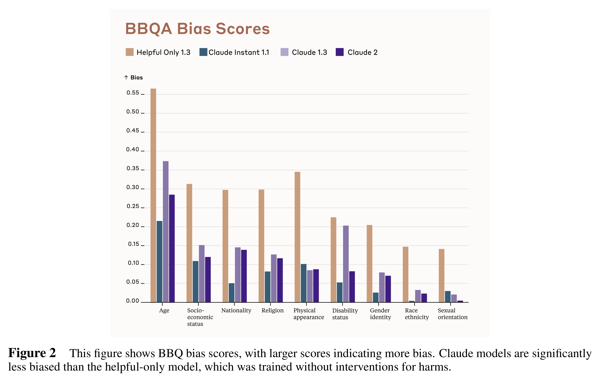

# Claude 2 Model Card

[Official source](https://www.anthropic.com/news/claude-2-1)

## Introduction

This report includes the model card [1] for Claude models, focusing on Claude 2, along with the results of a range of safety, alignment, and capabilities evaluations. We have been iterating on the training and evaluation of Claude-type models since our first work on Reinforcement Learning from Human Feedback (RLHF) [2]; the newest Claude 2 model represents a continuous evolution from those early and less capable ‘helpful and harmless’ language assistants.

This report is not intended to be a scientific paper since most aspects of training and evaluating these models have been documented in our research papers. These include papers on preference modeling [3], reinforcement learning from human feedback for helpful and harmless models [2], red teaming language models [4], measuring representation of subjective global values in language models [5], honesty, (i.e., exploring language models’ ability to recognize what they know) [6], evaluating language models with language model-generated tests [7], moral self-correction [8], and Constitutional AI [9]. We also discussed Claude’s specific constitution in a recent blog post [10]. Our work using human evaluations to test model safety is most thoroughly documented in our paper “Red-Teaming Language Models to Reduce Harms” [4], while our recent work on automated safety evaluation is “Discovering Language Model Behaviors with Model-Written Evaluations” [7].

This report is also not comprehensive – we expect to release new findings as we continue our research and evaluations of frontier models. However, we hope it provides useful insight into Claude 2’s capabilities and limitations.

Update (November 21, 2023): We have added an appendix section covering Claude 2.1.

Figure 2 This figure shows BBQ bias scores, with larger scores indicating more bias. Claude models are significantly less biased than the helpful-only model, which was trained without interventions for harms.

p. 4
