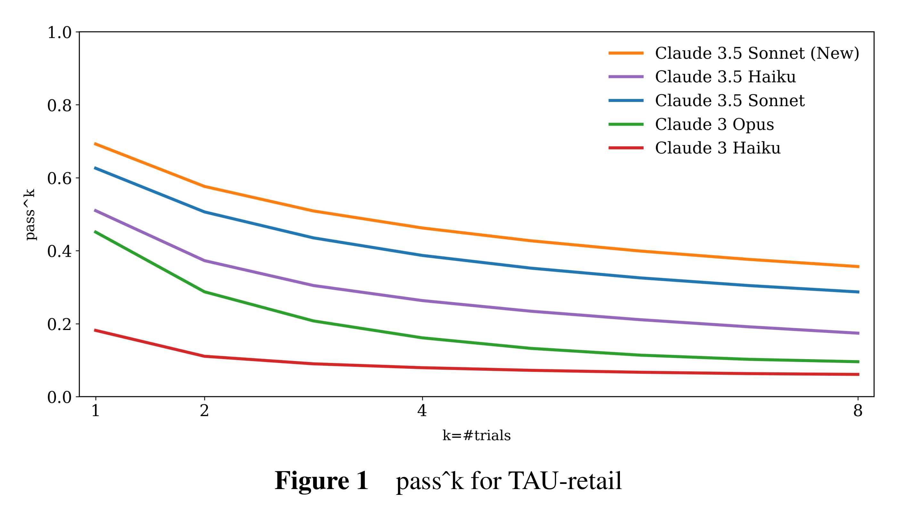

# Model Card Addendum: Claude 3.5 Haiku and Upgraded Claude 3.5 Sonnet

[Official source](https://www.anthropic.com/system-cards)

## Introduction

This addendum describes two new models in the Claude 3 family: an upgraded version of Claude 3.5 Sonnet and the new Claude 3.5 Haiku. These models advance capabilities in reasoning, coding, and visual processing and demonstrate new competencies and performance improvements. This addendum provides detailed discussion of the performance and safety considerations for these new models. It includes updated benchmark results, human feedback evaluations, and in-depth analyses of the models’ behavior in areas such as reasoning, coding, and visual processing.

The upgraded Claude 3.5 Sonnet model improves upon its predecessor’s capabilities and introduces new functionalities. Most notably it possesses the ability to use computers – allowing the model to interpret screenshots of a Graphical User Interface (GUI) and generate appropriate tool calls to perform requested tasks. This advancement enables Claude to navigate websites, interact with user interfaces, and complete complex multi-step processes. This opens up new possibilities for automation and task completion. With this nascent skill and other improvements, the upgraded Claude 3.5 Sonnet model sets new state-of-the-art standards in areas such as agentic coding (SWE-bench Verified [1]), agentic task completion (TAU-bench (τ -bench) [2]), and computer use from screenshots (OSWorld [3]).

Claude 3.5 Haiku, our newest addition to the family, also achieves strong performance among models in its class. It demonstrates improvements over its predecessor and in many cases performs comparably to the original Claude 3.5 Sonnet and Claude 3 Opus models – particularly in tasks requiring reasoning and instruction following.

Both models underwent extensive safety evaluations, including comprehensive testing for potential risks in biological, cybersecurity, and autonomous behavior domains, in accordance with our Responsible Scaling Policy (RSP) [4]. Our safety teams conducted rigorous multimodal red-team exercises, including specific evaluations for computer use, to help ensure alignment with Anthropic’s Usage Policy [5].

As part of our continued effort to partner with external experts, joint pre-deployment testing of the new Claude 3.5 Sonnet model was conducted by the US AI Safety Institute (US AISI) [6] and the UK AI Safety Institute (UK AISI) [7]. We also collaborated with METR [8] to conduct an independent assessment.

As we continue to advance our AI technology, we remain dedicated to transparency and responsible development. This addendum serves to document the progress we’ve made and to provide our users and the broader AI community with comprehensive information about these latest additions to the Claude family, including both their enhanced capabilities and our ongoing commitment to safety and ethical AI development.

Figure 1 passˆk for TAU-retail

p. 4
