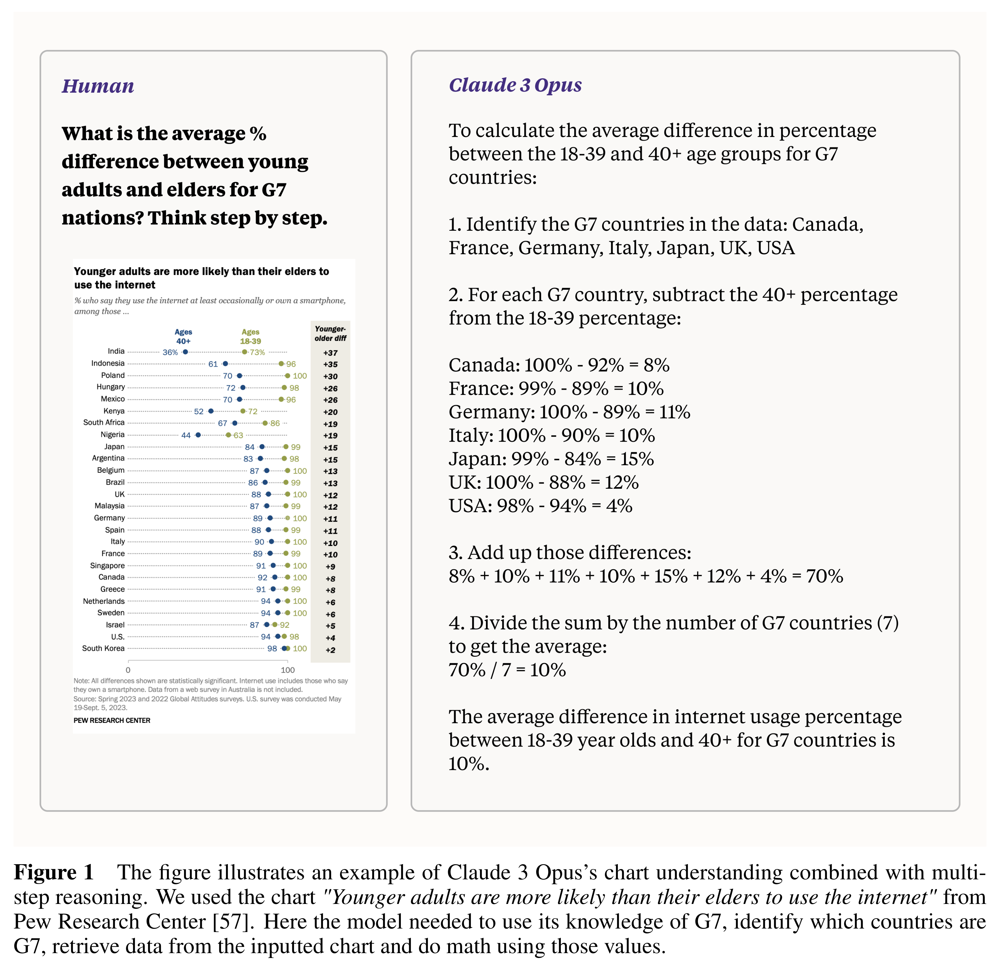

# Claude 3 Model Card

[Official source](https://www.anthropic.com/system-cards)

## Abstract

We introduce Claude 3, a new family of large multimodal models – Claude 3 Opus, our most capable offering, Claude 3 Sonnet, which provides a combination of skills and speed, and Claude 3 Haiku, our fastest and least expensive model. All new models have vision capabilities that enable them to process and analyze image data. The Claude 3 family demonstrates strong performance across benchmark evaluations and sets a new standard on measures of reasoning, math, and coding. Claude 3 Opus achieves state-of-the-art results on evaluations like GPQA [1], MMLU [2], MMMU [3] and many more. Claude 3 Haiku performs as well or better than Claude 2 [4] on most pure-text tasks, while Sonnet and Opus significantly outperform it. Additionally, these models exhibit improved fluency in non-English languages, making them more versatile for a global audience. In this report, we provide an in-depth analysis of our evaluations, focusing on core capabilities, safety, societal impacts, and the catastrophic risk assessments we committed to in our Responsible Scaling Policy [5].

Update (June 20, 2024): We have added an addendum covering Claude 3.5 Sonnet. Update (October 22, 2024): We have added an addendum covering an upgrade to Claude 3.5 Sonnet and Claude 3.5 Haiku.

Figure 1 The figure illustrates an example of Claude 3 Opus’s chart understanding combined with multi-step reasoning. We used the chart "Younger adults are more likely than their elders to use the internet" from Pew Research Center [57]. Here the model needed to use its knowledge of G7, identify which countries are G7, retrieve data from the inputted chart and do math using those values.

p. 9
