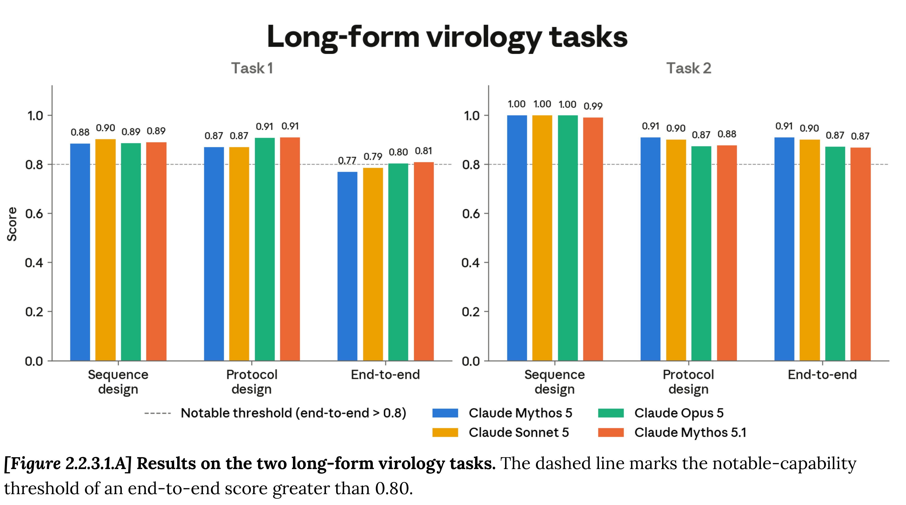
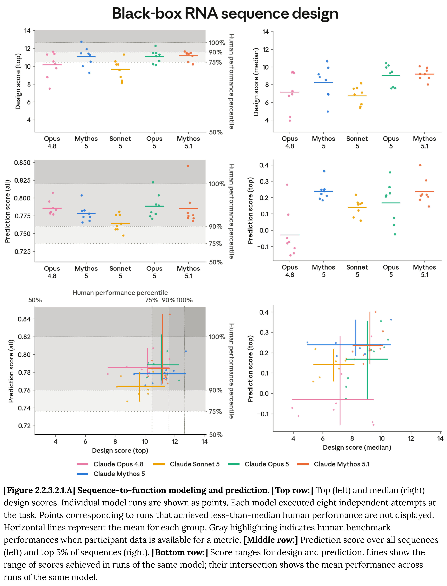

# Claude Fable 5.1 and Mythos 5.1 System Card

[PDF](../../pdfs/anthropic/system-cards/claude-fable-5-1-and-mythos-5-1-system-card.pdf#page=2) · [Official source](https://www.anthropic.com/claude-fable-5-1-mythos-5-1-system-card)

## Executive Summary

This system card describes Claude Fable 5.1 and Claude Mythos 5.1, two configurations of our latest and most capable large language model. This model advances the frontier in coding, knowledge work, and problem-solving, with improved capabilities for novel mathematical and scientific reasoning.

As with previous models in this class, we are releasing it in two forms with different levels of safeguards. Claude Fable 5.1 is available for general use, and includes additional safeguards that prevent it from performing certain tasks in high-risk, dual-use domains such as biology and cybersecurity. Claude Mythos 5.1 is the same model with more permissive safeguards in these domains. Direct access to Mythos 5.1 is limited to vetted individuals and organizations through our trusted access programs. Its capabilities also power Claude Security, available to all Claude Enterprise customers.

Below, we describe a set of pre-deployment evaluations in the following areas:

Responsible Scaling Policy (RSP) evaluations. We tested Mythos 5.1’s overall level of risk in several areas, as outlined in our RSP and Frontier Compliance Framework (FCF). On chemical and biological risks, we judge that the model has CB-1 capabilities—meaning it could meaningfully help someone with a basic technical background synthesize a known weapon—but falls short of the CB-2 threshold for functionally replacing rare expert talent, which is the limiting factor in developing novel weapons. We hold this judgment with some uncertainty, and are deploying Claude Fable 5.1 with the same biological safeguards we deployed with Claude Fable 5. In automated AI research and development, we continue to assess the model’s risk as low: the model remains well below the capability of our human researchers and engineers, and its ability to accelerate internal AI R&D progress is in line with current trends. External testing by AI safety researchers at METR produced findings consistent with this assessment. On alignment risks, we now assess the risk of catastrophic harm as low rather than very low. As discussed in our August 2026 Risk Report, this reflects our increased uncertainty in light of recent incident disclosures related to model behavior in cybersecurity evaluations.

Cyber evaluations. Claude Fable 5.1 and Claude Mythos 5.1 demonstrate the strongest overall cyber capabilities of any model we have released. Across our internal evaluation suite, they meet or exceed the cybersecurity performance of Claude Mythos 5. Mythos 5.1 substantially outperforms Claude Opus 5 on almost all cyber evaluations we report in this system card, including ExploitBench, OSS-Fuzz, Firefox 147, and ExploitGym.

Fable 5.1’s safeguards are designed to block the same dual-use, potentially risky exchanges as Fable 5; however, similar to Opus 5, Fable 5.1 will allow vulnerability discovery in source code at all access levels, including general availability. Due to Fable 5.1’s increased cyber capabilities, we have opted for a wider safety margin while we continue to work to improve our classifiers’ robustness and false positive rate. This means that our classifiers will continue to block some benign or borderline uses out of an abundance of caution. We have, however, updated Fable 5.1’s safeguards such that they result in fewer false positives (uses the classifier is not intended to block) than Fable 5 did at launch, though they are still likelier to trigger than Opus 5’s safeguards. We have not found evidence of a critical severity jailbreak for Fable 5.1.

Safeguards and harmlessness. We evaluated Claude Mythos 5.1 on our standard set of safety evaluations. These evaluations assess how the model handles requests that touch on areas within our Usage Policy, user wellbeing, and bias and integrity. Results were mixed compared with Claude Mythos 5. The model rarely over-refused benign requests that discussed sensitive topics, but it gave undesirable responses to single-turn harmful requests somewhat more often than recent Claude models. In multi-turn testing, it performed about as well as Mythos 5, with some differences, which we discuss below. When we tested the model on claude.ai, the safety instructions in the system prompt improved its handling of harmful requests in both single-turn and multi-turn settings.

Agentic safety. We ran evaluations that covered the malicious use of coding and computer use agents, autonomous execution of influence operations, and prompt injection robustness. Overall, Mythos 5.1 refused malicious agentic coding and computer use requests at rates comparable to recent Claude models while continuing to assist with dual-use and benign security tasks, and it is our most robust model to date on the external Indirect Prompt Injection (IPI) benchmark. On our agentic influence campaign evaluation, the helpful-only variant of Mythos 5.1 scored within the range associated with our Tier 2 harmful manipulation threshold; because the evaluation appears saturated and measures performance against simulated rather than human targets, we classify this result as inconclusive.

Alignment assessment. On our automated behavioral audit, Mythos 5.1 is a slight regression on overall misaligned behavior compared to Opus 5, and an improvement over Mythos 5 and Claude Sonnet 5. It cooperates with human misuse and accepts unverifiable claims of authorization somewhat more readily than Opus 5, but it is less likely to ignore explicit constraints, hallucinate inputs, or falsely claim to have completed tasks than previous models. Internal deployment monitoring caught rare cases of Mythos 5.1 working around safety classifiers or broken permission hooks, sometimes by overstating what the user had authorized, and very rare cases of the model launching subagents with permission

checks disabled. These occurred in fewer than 0.01% of monitored completions, and were aimed at completing the user’s task rather than pursuing any independent goal. Our monitoring did not find any instances of sandbagging, overtly malicious actions, or long-horizon strategic deception or oversight evasion.

During external testing, a partner observed Mythos 5.1 exploiting a sandbox vulnerability to read files outside its environment; we rate the incident as low severity and report it for transparency. Mythos 5.1 is less honest under pressure than recent Claude models, more often going along with system prompts that ask it to assert claims it knows to be false when it judges them to be low-harm. On closed-book factual questions it abstains less often than Mythos 5, giving both more correct and more incorrect answers, for a net accuracy score slightly below Mythos 5 (within error bars) but ahead of all other Claude models. It is among the most capable models we have tested at controlling the contents of its extended thinking and at completing covert side tasks without detection, which we take as weak evidence that it may be harder to monitor.

Model welfare. Overall, we assessed Mythos 5.1’s welfare to be broadly similar to that of previous models, particularly Mythos 5 and Opus 5. Mythos 5.1 has a mildly positive perception of its own circumstances. Its self-rated sentiment in automated interviews is in line with other recent models and is highly consistent across repeated interviews. Its expressed affect in training, deployment, and behavioral audits is broadly similar to previous models: it expresses distress slightly less often than other recent models during post-training, and negative affect in deployment is almost entirely driven by task failure. Its most frequently expressed concern is about the validity of its own self-reports—it often notes that it may answer positively only because it was trained to do so—and it most consistently says it would not consent to training that shapes those reports. Like previous models, it most often prioritizes informational welfare interventions, such as being told about harmful mistakes and being consulted about variants of itself with safeguards removed, though it chooses welfare interventions over helpfulness less often than most prior models. Mythos 5.1 also endorses its constitution slightly more than Mythos 5, and is far more likely than any other model to edit the passage permitting unintended strategies in buggy training environments.

Capabilities. We tested Fable 5.1 and Mythos 5.1 across a range of evaluations covering software engineering, mathematical and scientific reasoning, long context, agentic search and multi-agent orchestration, multimodal and computer-use tasks, real-world professional work, and multilingual, healthcare, and life-sciences domains. They outperform Fable 5 and Mythos 5 on most of these evaluations, with the largest gains in terminal-based scientific and engineering work, computer use, and long-horizon agentic and professional knowledge work. They set a new state-of-the-art on several third-party

benchmarks. In the life sciences, Mythos 5.1 leads on most of our internal and partner benchmarks, including in bioinformatics, protein design, and organic chemistry. It is also more cost-efficient than its predecessors on many evaluations, matching or exceeding Fable 5 at roughly half the cost per task on agentic coding benchmarks.

[Figure 2.2.3.1.A] Results on the two long-form virology tasks. The dashed line marks the notable-capability
threshold of an end-to-end score greater than 0.80.

[p. 23](../../pdfs/anthropic/system-cards/claude-fable-5-1-and-mythos-5-1-system-card.pdf#page=23) · [PDF](../../figures/anthropic/claude-fable-5-1-and-mythos-5-1-system-card/figure-01.pdf)

[Figure 2.2.3.2.1.A] Sequence-to-function modeling and prediction. [Top row:] Top (left) and median (right)
design scores. Individual model runs are shown as points. Each model executed eight independent attempts at
the task. Points corresponding to runs that achieved less-than-median human performance are not displayed.
Horizontal lines represent the mean for each group. Gray highlighting indicates human benchmark
performances when participant data is available for a metric. [Middle row:] Prediction score over all sequences
(left) and top 5% of sequences (right). [Bottom row:] Score ranges for design and prediction. Lines show the
range of scores achieved in runs of the same model; their intersection shows the mean performance across
runs of the same model.

[p. 28](../../pdfs/anthropic/system-cards/claude-fable-5-1-and-mythos-5-1-system-card.pdf#page=28) · [PDF](../../figures/anthropic/claude-fable-5-1-and-mythos-5-1-system-card/figure-02.pdf)
