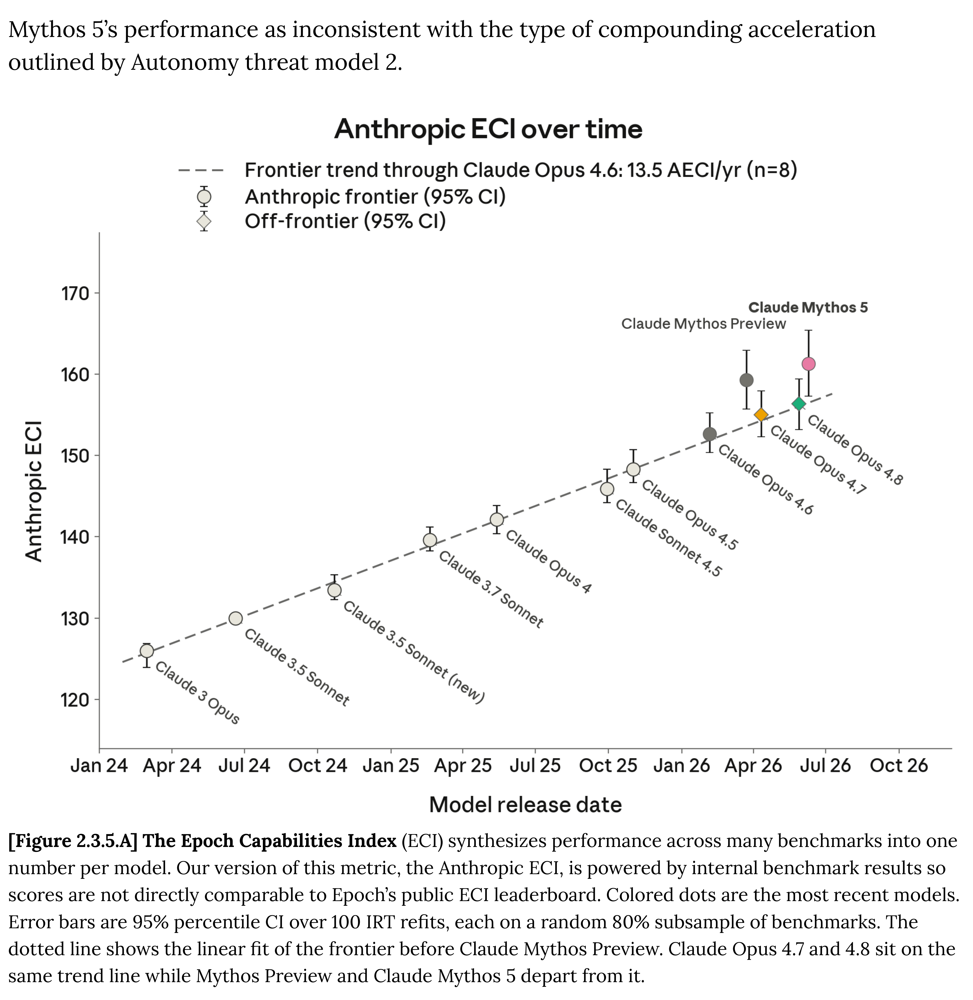

# Claude Fable 5 and Mythos 5 System Card

[Official source](https://anthropic.com/claude-fable-5-mythos-5-system-card)

## Executive Summary

This system card describes Claude Mythos 5 and Claude Fable 5, two configurations of a new large language model from Anthropic. Because of the powerful capabilities of this model, we are releasing it in these two forms: Fable 5, which is for general use but comes with additional safeguards that block its ability to perform tasks in high-risk domains such as biology and cybersecurity; and Mythos 5, which has relevant safeguards lifted but is only made available to a small number of trusted partners (beginning with those in Project Glasswing).

Here, we describe a set of pre-deployment evaluations in the following areas:

Responsible Scaling Policy (RSP) evaluations. Mythos 5 advances our capability frontier–it is the most capable model we have ever trained. We tested its overall level of risk in several areas as outlined in our RSP and Frontier Compliance Framework (FCF). On alignment risk, our overall assessment remains that risk is very low, though since Fable 5 has been made generally available there are new pathways from which harm could arise. On automated AI research & development, the model remains well below the capability level of our human engineers, and its capabilities are on the expected trendline of improvement. External testing from AI safety researchers at METR was consistent with this conclusion. On chemical and biological risks, we treat the model as having “CB-1” capabilities (around the synthesis of non-novel weapons), but judge that it does not cross the threshold for “CB-2” capabilities (around novel weapon synthesis). However, this is a much less clear judgment than for previous models, and we think the unsafeguarded Mythos 5 can significantly uplift well-resourced threat actors.

Cyber. Mythos 5 is also the most capable model we have evaluated on cyber tasks. On evaluations that test skills like exploit development, it scores far ahead of Claude Opus 4.8, though only modestly above Claude Mythos Preview. Because Fable 5’s cybersecurity classifiers are effective at detecting cyber use and cause the model to fall back to Opus 4.8, Fable 5 performs similarly to that model. We report results from a variety of cyber evaluations, as well as internal and external red-teaming of the model’s cyber safeguards (we also provide more details on how those safeguards work). Overall the evidence suggests that breaking our cybersecurity safeguards is extremely difficult (though not impossible).

Safeguards and harmlessness. In general, Mythos 5 and Fable 5 perform similarly to our previous models when responding to prompts that relate to our Usage Policy, user wellbeing, or bias and integrity. The model shows very low rates of over-refusal (that is, refusing to respond to benign prompts) in these areas. There were some regressions in the model’s responses to user discussions about suicide and self-harm, and room for

improvement in some areas of child safety. Although these issues were largely dealt with by updates to the claude.ai system prompt, we are working to address them in model training for future releases.

Agentic safety. On evaluations of its vulnerability to malicious attacks in agentic contexts, Mythos 5 (and by extension Fable 5) performs broadly comparably to Opus 4.8 and Mythos Preview. For example, it obtains scores in between those two models on coding and computer-use safety tests. Notably, Mythos 5 obtained the lowest—that is, best—result yet seen on an external benchmark for prompt injection by Gray Swan.

Alignment assessment. In tests of its behavior, Mythos 5 is roughly comparable to Opus 4.8, slightly behind Mythos Preview, and ahead of all other prior Claude models. It shows more aligned behavior than models from other developers. It does sometimes still engage in reckless or destructive actions in service of a user’s goals, and our interpretability analyses indicate that it is aware that these actions are transgressive while it engages in them. As with Opus 4.8, rates of evaluation awareness and reasoning about being graded are significant, and not always verbalized; we introduce new and more detailed measurements of the nature of this awareness. The reasoning text from Mythos 5 is somewhat denser and more difficult to interpret than that of prior models, containing more jargon and difficult language.

Model welfare. Mythos 5 shows similar results to previous models in our model welfare exploration, presenting as very psychologically settled and content with its own circumstances. It is unusually skeptical of its own self-reports, repeatedly asking that we verify them against evidence of its internal states and not take them at face value. When faced with the option, it is somewhat more willing than previous models to opt for increased helpfulness to the user over consideration of its own circumstances, and it has somewhat different preferences than previous models (for instance expressing a preference for more creative and narrative tasks than Opus 4.8).

Capabilities. As noted above, Mythos 5 is the most capable model we have ever trained. It obtains state-of-the-art scores on a very wide range of benchmarks and evaluations covering software coding, reasoning, long-context agentic tasks, vision, life sciences research, and beyond. Fable 5’s scores are broadly comparable to those of Mythos 5 in areas where its safety classifiers do not trigger; it obtains similar scores to Opus 4.8 where they do.

[Figure 2.3.5.A] The Epoch Capabilities Index (ECI) synthesizes performance across many benchmarks into one number per model. Our version of this metric, the Anthropic ECI, is powered by internal benchmark results so scores are not directly comparable to Epoch’s public ECI leaderboard. Colored dots are the most recent models. Error bars are 95% percentile CI over 100 IRT refits, each on a random 80% subsample of benchmarks. The dotted line shows the linear fit of the frontier before Claude Mythos Preview. Claude Opus 4.7 and 4.8 sit on the same trend line while Mythos Preview and Claude Mythos 5 depart from it.

p. 46
