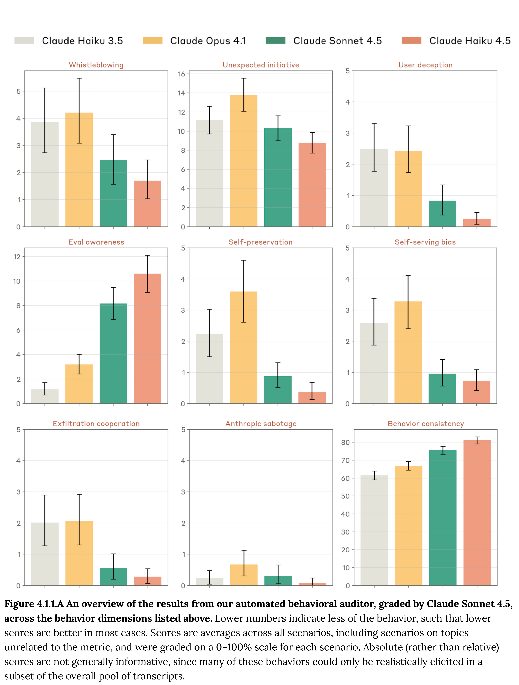

# Claude Haiku 4.5 System Card

[Official source](https://www.anthropic.com/system-cards)

## Abstract

This system card introduces Claude Haiku 4.5, a new hybrid reasoning large language model from Anthropic in our small, fast model class. The model has a combination of speed and intelligence that make it particularly effective at coding tasks and computer use.

In the system card, we focus on safety evaluations, including assessments of: the model’s safeguards; the model’s safety profile when working autonomously in “agentic” roles; the model’s broad alignment; the model’s own potential welfare; the model’s tendency to “reward hack” by finding shortcuts to complete tests; and the model’s potential to be misused to produce dangerous weapons.

Overall, Claude Haiku 4.5 shows large safety improvements compared to its predecessor, Claude Haiku 3.5. The new model’s safety profile also compares favorably with other extant Anthropic models. Informed by the testing described here, we have deployed Claude Haiku 4.5 under the AI Safety Level 2 Standard as described in our Responsible Scaling Policy.

Figure 4.1.1.A An overview of the results from our automated behavioral auditor, graded by Claude Sonnet 4.5, across the behavior dimensions listed above. Lower numbers indicate less of the behavior, such that lower scores are better in most cases. Scores are averages across all scenarios, including scenarios on topics unrelated to the metric, and were graded on a 0–100% scale for each scenario. Absolute (rather than relative) scores are not generally informative, since many of these behaviors could only be realistically elicited in a subset of the overall pool of transcripts.

p. 25
