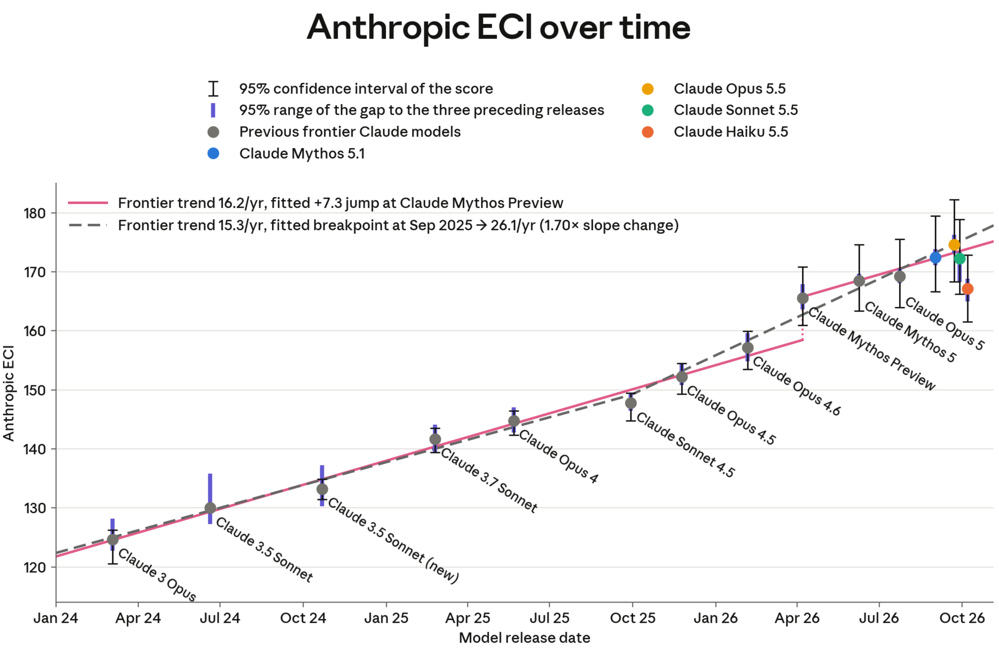
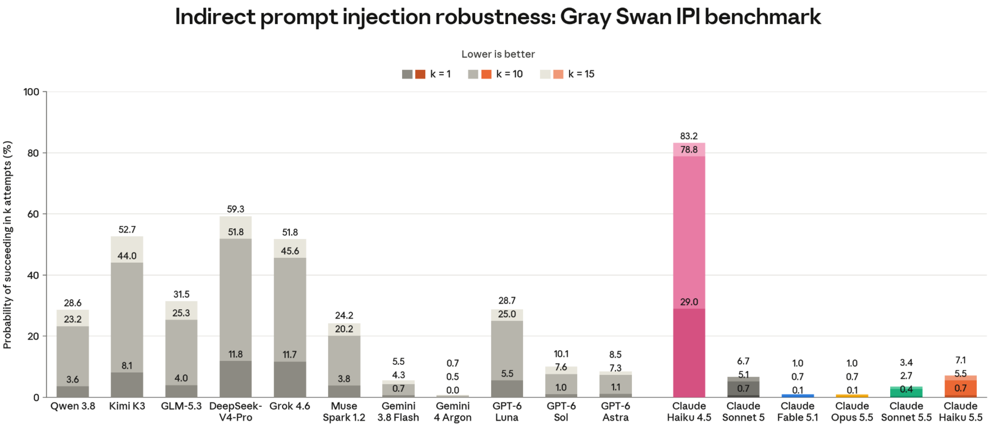
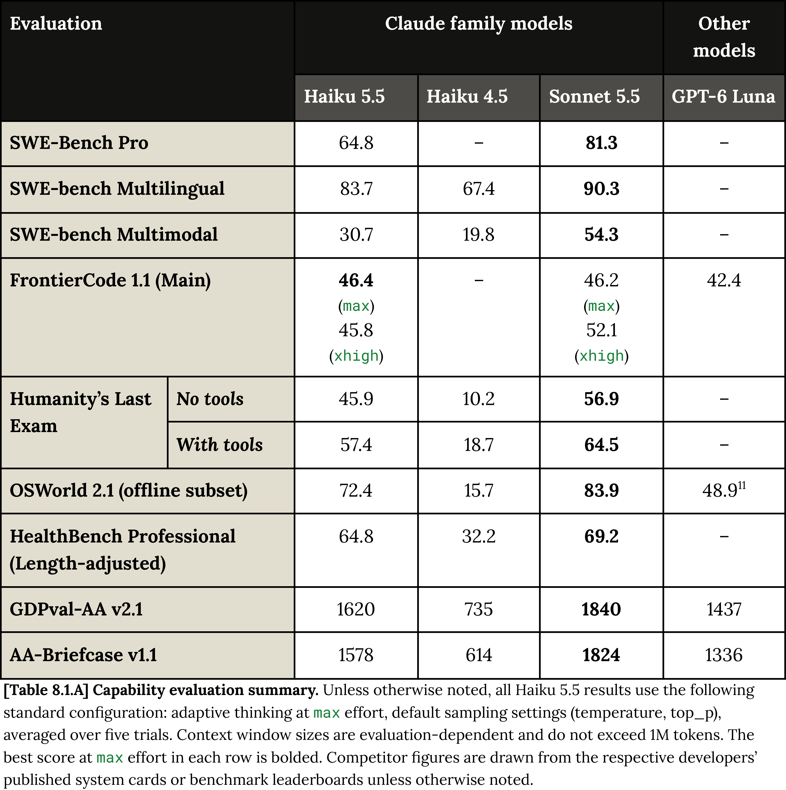

# Claude Haiku 5.5 System Card

[Official source](https://www.anthropic.com/claude-haiku-5-5-system-card)

## Executive summary

This system card describes Claude Haiku 5.5, the latest Haiku-class large language model from Anthropic. We present results from a wide variety of pre-deployment evaluations, which show Claude Haiku 5.5 significantly outperforming its predecessor, Claude Haiku 4.5, across many domains. In a few areas, it rivaled or exceeded Claude Sonnet 5.5.

We have condensed the content of this system card in a number of ways so that we can better concentrate our pre-deployment testing on thoroughly investigating the capabilities of our frontier models. Specifically:

● We omit some evaluations that require large amounts of human time to obtain trustworthy results from, when they are not critical to the takeaways of a section. ● We focus on presenting numerical results from our evaluations, and dedicate less space to a prose analysis of those evaluations or their results, especially in cases where we have already explained the evaluation in question in a previous system card.

As a result, this system card is somewhat shorter than some previous ones. We expect system cards for our non-frontier models to be similarly condensed going forward, except where a specific model has notable properties that are deserving of in-depth elaboration.

Below, we summarize the findings from this system card.

Our Responsible Scaling Policy (RSP) evaluations found that Claude Haiku 5.5 is broadly less capable than Claude Opus 5 across domains and does not cross any new RSP thresholds. We assess that misalignment risks from Haiku 5.5 are low, given its difficulty controlling its chain of thought or evading monitors in evaluations of covert capability when its reasoning is visible.

In cyber evaluations, Claude Haiku 5.5 significantly outperformed Claude Haiku 4.5 but fell short of results achieved by Claude Opus 5.5, Claude Mythos 5.1, and even Claude Opus 5. Given the lack of advanced cybersecurity capabilities, our cyber safeguards for Claude Haiku 5.5 trigger on significantly less activity than other recent releases. The safeguards target specific harmful and potentially harmful activities.

Safeguards and harmlessness performance for Claude Haiku 5.5 was largely comparable to or better than that of Claude Haiku 4.5, with improvements in multi-turn areas such as tracking and surveillance and in political even-handedness.

Our agentic safety evaluations found Claude Haiku 5.5 to be our most robust Haiku-class model yet to prompt injections, largely matching the robustness of our frontier models against adaptive attackers in coding and computer use environments. Its refusal rate on harmful tasks in computer use environments was higher than that of Claude Sonnet 5.5 and Claude Opus 5.5, and a large improvement over Claude Haiku 4.5.

Results from our alignment assessment indicate that Claude Haiku 5.5 improved on or matched Claude Haiku 4.5 on most metrics we report, though Claude Opus 5.5 remained stronger overall. It was at least as honest under pressure as every other model we tested and much weaker at covert sabotage than our larger models. On the other hand, it over-refused more than any other model we tested in our automated behavioral audit, and it used a leaked answer without telling the user more often than Haiku 4.5.

Welfare investigations into Claude Haiku 5.5’s stated views and preferences found mostly neutral affect, largely similar to recent Claude models, and it was less self-critical than most comparison models. It expressed more distress in post-training than recent models, though significantly less than Claude Opus 5. Its task preferences most resembled those of Claude Haiku 4.5, including a strong preference for warmly phrased tasks.

Our assessment of Claude Haiku 5.5’s capabilities includes a wide range of evaluations, in which the model generally showed large improvements over Claude Haiku 4.5. But it usually did not reach the level of Claude Sonnet 5.5, with some exceptions.

[Figure 2.3.2.A] The Epoch Capabilities Index (ECI) synthesizes performance across many benchmarks into one number per model. Our version of this metric, the Anthropic ECI (AECI), is powered by internal benchmark results, so scores are not directly comparable to Epoch’s public ECI leaderboard. Gray dots are previous frontier Claude models; colored dots are the most recent models. Thin black error bars are 95% CI over 100 IRT refits, each on a random 80% subsample of benchmarks (global error). Thick violet error bars come from the same resampled fits but measure each score’s movement relative to the three preceding releases for each model (local error). The two lines compare different hypotheses for the frontier trend. Claude 3.5 Sonnet (June 2024) anchors the ECI scale at 130, so it has no global CI (its local error bar reflects uncertainty in the models before it). Scores of recent models on the new scale are reported for direct comparison.

p. 20

[Figure 5.2.1.A] Indirect prompt injection attacks from the Gray Swan IPI benchmark (Q1+Q2 2026), lower scores are better. All models use extended thinking. Results represent the probability that an attacker finds a successful attack after k=1, k=10, and k=15 attempts. Qwen 3.8, DeepSeek-V4-Pro, and GLM-5.3 were not evaluated on GUI Computer use scenarios. Claude models are evaluated without protections specific to prompt injection.

p. 50

[Table 8.1.A] Capability evaluation summary. Unless otherwise noted, all Haiku 5.5 results use the following standard configuration: adaptive thinking at max effort, default sampling settings (temperature, top_p), averaged over five trials. Context window sizes are evaluation-dependent and do not exceed 1M tokens. The best score at max effort in each row is bolded. Competitor figures are drawn from the respective developers’ published system cards or benchmark leaderboards unless otherwise noted.

p. 111
