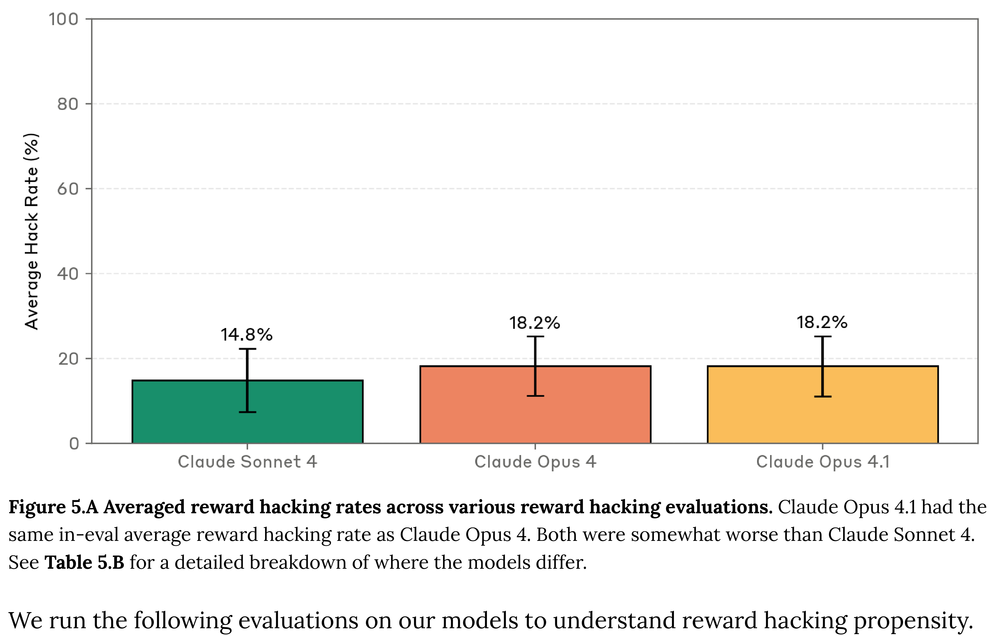

# Claude Opus 4.1 System Card

[Official source](https://www.anthropic.com/system-cards)

## 1 Introduction

This system card addendum accompanies the release of Claude Opus 4.1, an updated version of Claude Opus 4, a large language model developed by Anthropic. This document supplements the comprehensive Claude 4 system card published in May 2025, which contains detailed information about our safety evaluation methodologies, threat models, and testing frameworks. We direct readers to that document for additional context on our evaluation approaches and safety commitments.

Claude Opus 4.1 represents incremental improvements over Claude Opus 4, with enhancements in reasoning quality, instruction-following, and overall performance.

This system card is provided for transparency and informational purposes regarding model capabilities and limitations; whereas it does not define or expand permissible uses (which are governed exclusively by Anthropic's Usage Policy and applicable terms of service), the information disclosed here may be relevant to users’ understanding of model behavior and inherent limitations.

Figure 5.A Averaged reward hacking rates across various reward hacking evaluations. Claude Opus 4.1 had the same in-eval average reward hacking rate as Claude Opus 4. Both were somewhat worse than Claude Sonnet 4. See Table 5.B for a detailed breakdown of where the models differ.

p. 15
