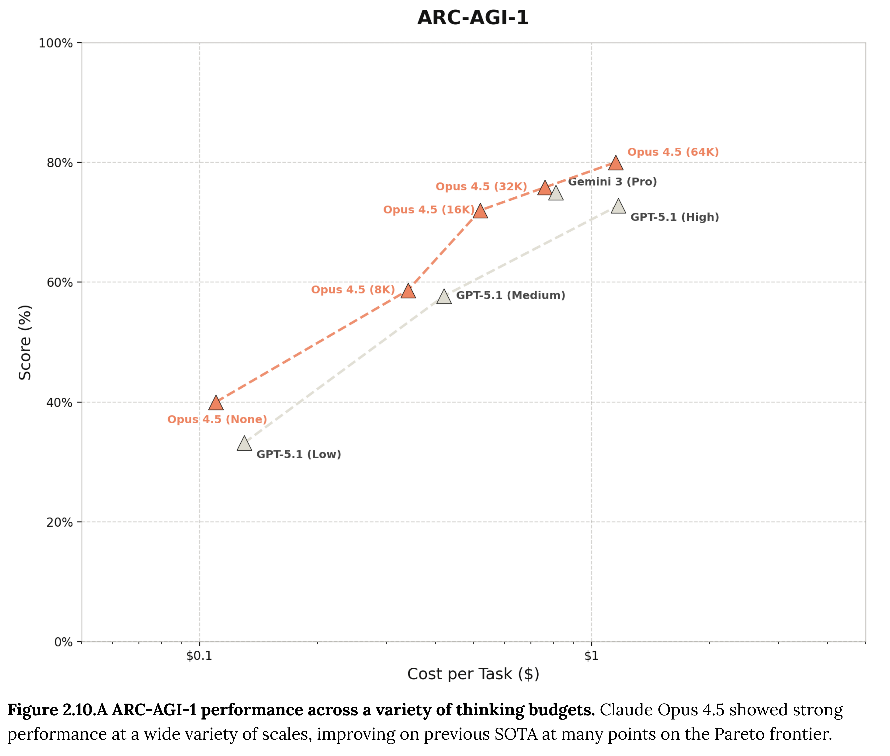

# Claude Opus 4.5 System Card

[Official source](https://www.anthropic.com/system-cards)

## Abstract

This system card describes our evaluations of Claude Opus 4.5, a large language model from Anthropic. Claude Opus 4.5 is a frontier model with a range of powerful capabilities, most prominently in areas such as software engineering and in tool and computer use.

This system card provides a detailed assessment of the model’s capabilities. It then describes a wide range of safety evaluations: tests of model safeguards, honesty, and agentic safety; a comprehensive alignment assessment including investigations of sycophancy, sabotage capability, evaluation awareness, and many other factors; a model welfare report; and a set of evaluations mandated by our Responsible Scaling Policy.

Testing found Claude Opus 4.5 has several state-of-the-art capabilities. It also found it to be a broadly well-aligned model, with low rates of undesirable behavior. Informed by the testing described here, we have deployed Claude Opus 4.5 under the AI Safety Level 3 Standard.

Figure 2.10.A ARC-AGI-1 performance across a variety of thinking budgets. Claude Opus 4.5 showed strong performance at a wide variety of scales, improving on previous SOTA at many points on the Pareto frontier.

p. 28
