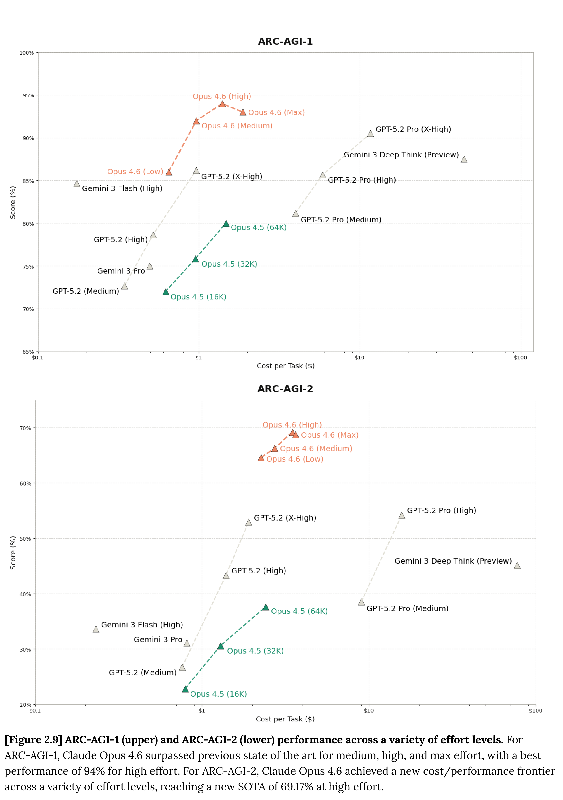

# Claude Opus 4.6 System Card

[Official source](https://anthropic.com/claude-opus-4-6-system-card)

## Abstract

This system card describes Claude Opus 4.6, a large language model from Anthropic. Claude Opus 4.6 is a frontier model with strong capabilities in software engineering, agentic tasks, and long context reasoning, as well as in knowledge work—including financial analysis, document creation, and multi-step research workflows.

This system card provides a detailed assessment of the model’s capabilities. It then describes a wide range of safety evaluations: tests of model safeguards (including new, higher-difficulty assessments); user wellbeing evaluations; assessments of honesty and agentic safety; a comprehensive alignment assessment including investigations of reward hacking, sabotage capability, evaluation awareness, model welfare, and many other factors; and a set of evaluations for dangerous capabilities mandated by our Responsible Scaling Policy. As part of the alignment assessment, we experimented with interpretability methods—including activation oracles, attribution graphs, and sparse autoencoder features—as practical tools for investigating model behavior.

Testing found Claude Opus 4.6 to have broadly improved capabilities compared to our previous models; many of its capabilities are state-of-the-art in the industry. Safety evaluations showed Opus 4.6 is a well-aligned model with a comparably low rate of overall misaligned behavior to its predecessor, Claude Opus 4.5. We did observe some increases in misaligned behaviors in specific areas, such as sabotage concealment capability and overly agentic behavior in computer-use settings, though none rose to levels that affected our deployment assessment.

Informed by the testing described here, we have deployed Claude Opus 4.6 under the AI Safety Level 3 Deployment and Security Standard.

​[Figure 2.9] ARC-AGI-1 (upper) and ARC-AGI-2 (lower) performance across a variety of effort levels.​​For​ ​ARC-AGI-1, Claude Opus 4.6 surpassed previous state of the art for medium, high, and max effort, with a best​ ​performance of 94% for high effort. For ARC-AGI-2, Claude Opus 4.6 achieved a new cost/performance frontier​ ​across a variety of effort levels, reaching a new SOTA of 69.17% at high effort.​

p. 23
