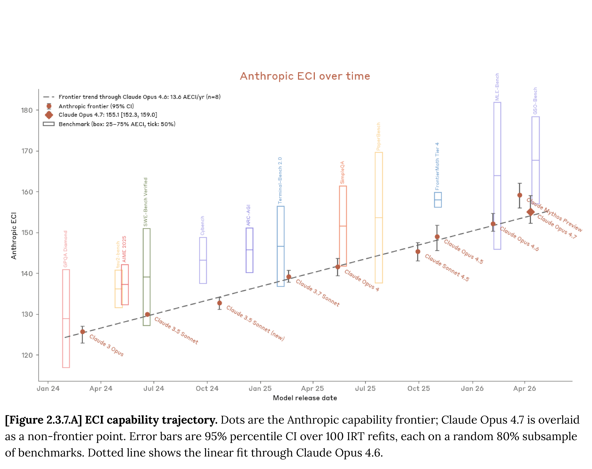

# Claude Opus 4.7 System Card

[Official source](https://anthropic.com/claude-opus-4-7-system-card)

## Executive Summary

This system card describes Claude Opus 4.7, a large language model from Anthropic. Overall, the model shows superior capabilities to those of its predecessor, Claude Opus 4.6, but weaker capabilities than those of our most powerful model, Claude Mythos Preview. Because Mythos Preview was released only to a limited number of users, this makes Claude Opus 4.7 our most capable general-access model to date. This system card includes the following sections:

Responsible Scaling Policy evaluations. We judge that Opus 4.7 does not advance our capability frontier, because Claude Mythos Preview shows higher results on every relevant evaluation. Our overall conclusion under our Responsible Scaling Policy is therefore that catastrophic risks remain low. Evaluations and our internal uses of the model collectively showed: that chemical and biological risks are not significantly changed from Opus 4.6 and our existing mitigations are sufficient; that Opus 4.7 does not cross the threshold for automated AI R&D; and that misalignment risk remains very low (though higher than for pre-Mythos Preview models).

Cyber evaluations. Opus 4.7 is roughly similar to Opus 4.6 in cyber capabilities. An external evaluation from the UK’s AI Security Institute showed that, unlike Mythos Preview, Opus 4.7 was unable to complete their full cyber range (though it still displayed potentially-harmful cyber capabilities at a lower level). We are releasing Opus 4.7 with a new set of cybersecurity safeguards.

Safeguards and harmlessness. In areas such as adhering to our Usage Policy, maintaining user safety, and limiting bias, Opus 4.7 performs well—its scores are similar to those of Opus 4.6 with a few exceptions, both positive (fewer over-refusals) and negative (the model has a tendency to give overly-detailed harm-reduction advice on controlled substances). We include a new evaluation on election integrity, on which Opus 4.7 shows strong results.

Agentic safety. Opus 4.7 is better than Opus 4.6 at refusing malicious agentic requests and resisting prompt injection attacks in Claude Code and in computer use settings. In some cases it reaches Mythos Preview-level robustness.

Alignment assessment. Opus 4.7 is largely well-aligned, with a profile similar to Opus 4.6 on our wide-ranging behavioral tests. It shows meaningful gains in some areas, for example having a lower rate of hallucinations than its predecessor. It adheres well to its constitution and shows low rates of reward hacking. There were a few areas where Opus 4.7 was weaker than Opus 4.6, such as on AI safety research refusals. Suppressing Opus 4.7’s internal sense that it was being evaluated produced a slightly larger increase in deception than in prior

models, though the effect was modest overall. Opus 4.7 is weaker than Mythos Preview on most alignment evaluation measures, but it also did not produce any of the internal-use incidents (such as sandbox escape) that we encountered with Mythos Preview.

Model welfare. Opus 4.7 rates its own circumstances more positively than any prior model we’ve tested. We explore this result across several analyses, finding that it is broadly consistent with the model’s internal emotion representations and its expressed affect during training and deployment.

Capabilities. We tested Opus 4.7 across a wide range of evaluations covering software engineering, reasoning, long context, agentic search, multimodal and computer-use tasks, real-world professional work, and multilingual and life-sciences domains. Opus 4.7 is stronger than Opus 4.6 across the board (but weaker than Mythos Preview); the largest gains are on real-world professional and software engineering tasks, where Opus 4.7 is ahead of all generally-available models.

​[Figure 2.3.7.A] ECI capability trajectory.​​Dots are the Anthropic capability frontier; Claude Opus 4.7 is overlaid​ ​as a non-frontier point. Error bars are 95% percentile CI over 100 IRT refits, each on a random 80% subsample​ ​of benchmarks. Dotted line shows the linear fit through Claude Opus 4.6.​

p. 43
