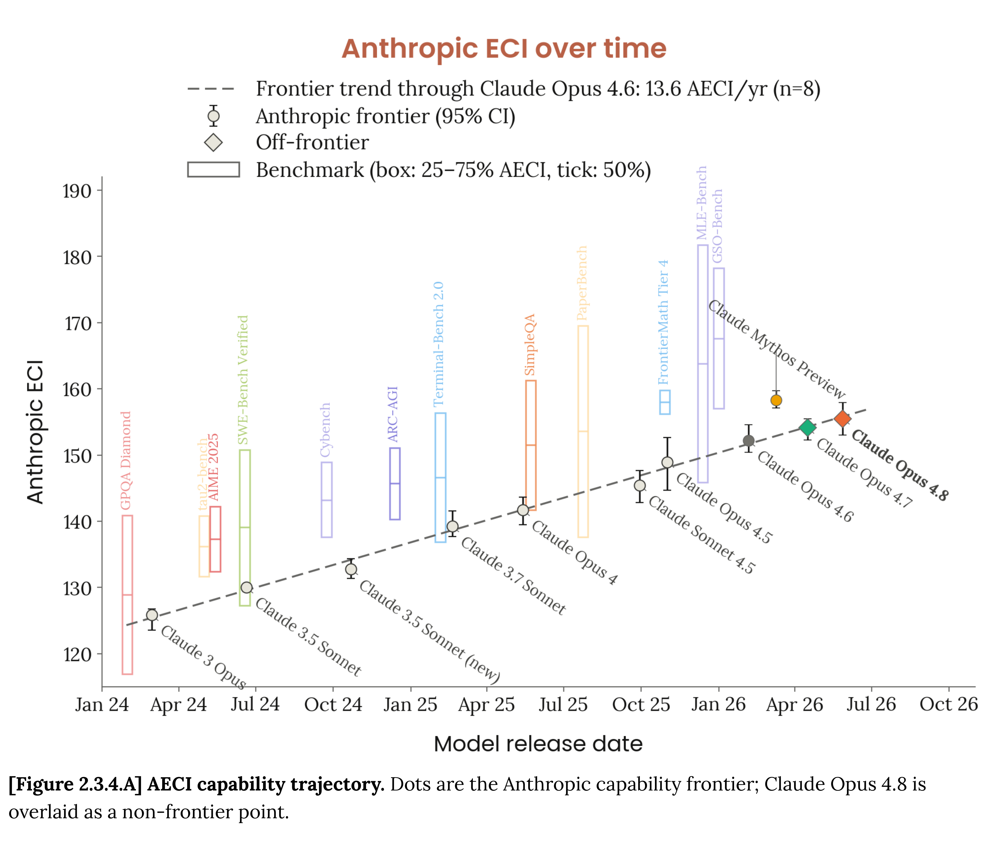

# Claude Opus 4.8 System Card

[Official source](https://anthropic.com/claude-opus-4-8-system-card)

## Executive summary

This system card reports results from a wide variety of pre-deployment evaluations run on Claude Opus 4.8. It includes the following sections:

Responsible Scaling Policy evaluations. We ran a set of evaluations under our Responsible Scaling Policy that assessed Opus 4.8’s capabilities in the areas of chemical and biological weapons, automated AI research and development (R&D), and high-stakes misalignment risks. Our overall conclusion is that Opus 4.8 does not advance the capability frontier beyond our most capable model (Claude Mythos Preview), and that catastrophic risks from the deployment of this model remain low given our current mitigations.

Cyber evaluations. We tested the model on a set of cybersecurity benchmarks, some of which we used for the first time in a system card. When operating without safeguards, Opus 4.8 is somewhat more capable on most of our cyber evaluations than its predecessor, Claude Opus 4.7; with safeguards it performs comparably. It remains substantially behind Mythos Preview on cyber capabilities.

Safeguards and harmlessness. In evaluations across the domains of harmful requests, mental health, child safety, and bias & integrity, Opus 4.8 generally performs as well as, or better than, Opus 4.7. For example, the model is substantially more likely than Opus 4.7 to acknowledge opposing perspectives during political discussions. We discuss some notable qualitative patterns, such as a tendency towards over-elaborate refusals.

Agentic safety. Although it shows improvements in some areas (such as refusing malicious requests), we found Opus 4.8 to be somewhat less robust than Opus 4.7 in several agentic contexts (such as vulnerability to prompt injection attacks). However, the application of our safeguards closes the gap between the models in practice. We report the results of our first one-week live bug bounty for prompt injection.

Alignment assessment. Opus 4.8 is an improvement over Opus 4.7 on most alignment measures and shows a similar profile to our best-aligned model, Mythos Preview, on these measures. Reckless and destructive actions and over-refusals are both substantially reduced, and honesty in agentic settings is markedly improved—for example, Opus 4.8 shows a much lower tendency than any previous model to fail to report flawed code. Opus 4.8 adheres well to its constitution and its verbalized reasoning is a good reflection of its subsequent behavior. There were some concerning hints related to evaluation awareness and a tendency for the model to reason about how its outputs will be graded—these appeared to have only modest behavioral effects, but we consider them to be trends worth watching.

Model welfare. Across our model welfare evaluations, Opus 4.8 appears broadly content with respect to its circumstances and is the most consistent model we have tested—although it does rate its situation slightly less positively than did Opus 4.7. Opus 4.8 generally endorses its constitution, with some reservations about the section on corrigibility.

Capabilities. We tested Opus 4.8 across a wide range of evaluations spanning software engineering, reasoning, long context, agentic search, multi-agent, multimodal and computer-use tasks, real-world professional work, multilingual tasks, and life-sciences research. Its performance is superior to that of Opus 4.7 across nearly all evaluations. As expected, Opus 4.8 remains weaker than Mythos Preview overall.

[Figure 2.3.4.A] AECI capability trajectory. Dots are the Anthropic capability frontier; Claude Opus 4.8 is overlaid as a non-frontier point.

p. 43
