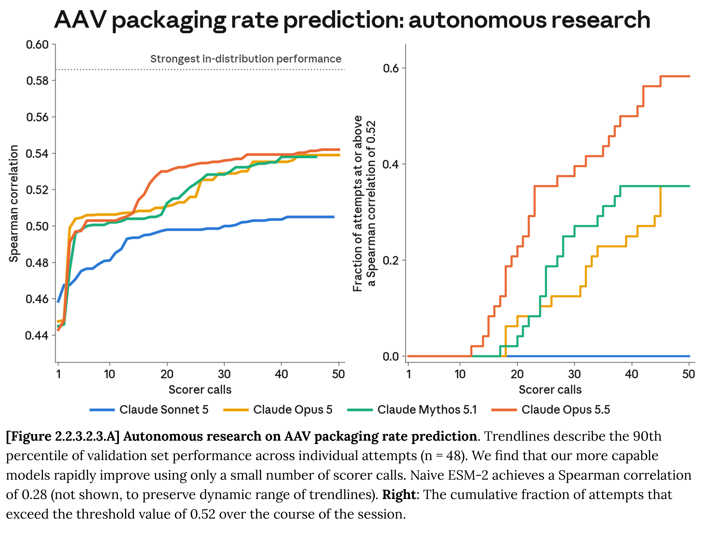
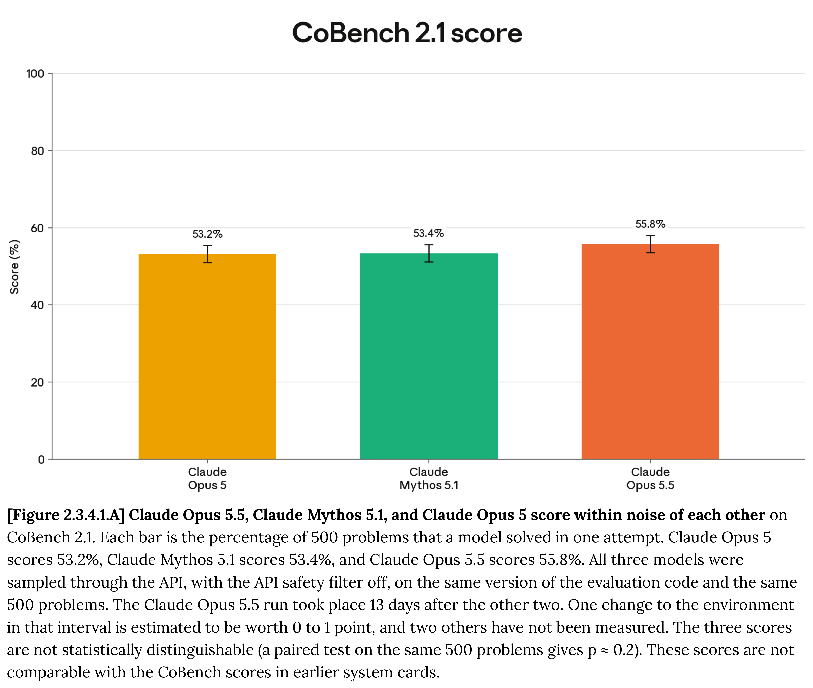

# Claude Opus 5.5 System Card

[Official source](https://www.anthropic.com/claude-opus-5-5-system-card)

## Executive Summary

This system card describes Claude Opus 5.5, the latest Opus-class large language model from Anthropic. It is an upgrade to Claude Opus 5, with gains in coding, agentic and computer use tasks, mathematical and scientific reasoning, and long-horizon professional work. On many evaluations, it matches or exceeds Claude Fable 5.1 and Claude Mythos 5.1.

Below, we describe a set of pre-deployment evaluations in the following areas:

Responsible Scaling Policy (RSP) evaluations. We tested Claude Opus 5.5’s overall level of risk in several areas, as outlined in our RSP and Frontier Compliance Framework (FCF).

On chemical and biological risks, we treat Opus 5.5 as having CB-1 capabilities (relating to the synthesis of non-novel weapons) but not CB-2 capabilities (relating to the synthesis of novel weapons). Across our evaluation portfolio it differed only modestly from Claude Mythos 5.1, and it did not improve on several of the weaknesses we considered disqualifying for CB-2 in that model. These failure modes limit its ability to substitute for scarce human expertise. We are deploying Claude Opus 5.5 with the same expanded biological safeguards that we have applied to Claude Fable 5 and Claude Fable 5.1.

Its AI R&D capabilities are at or slightly above those of Claude Mythos 5.1, but it remains far from substituting for our research scientists and engineers, and our internal measures do not show a sustained AI-attributable 2× acceleration in the pace of development. External testing produced findings consistent with this determination. On alignment risks, our overall assessment remains that the risk of catastrophic harm from misalignment is low, as set out in our August 2026 Risk Report.

Cyber evaluations. Across our internal evaluation suite, Claude Opus 5.5 meets or exceeds the performance of Claude Mythos 5.1 and Claude Opus 5 on all cyber evaluations we report in this system card. We see no indication that it can develop novel offensive capabilities. Its cyber safeguards enforce the same policy as those on Claude Opus 5, and are comparably robust to those on Claude Fable 5.1. Given Claude Opus 5.5’s capabilities, we have opted for a temporarily wider safety margin against jailbreaks, while we work to reduce our classifiers’ false-positive rate. We have not found evidence of a critical-severity jailbreak.

Safeguards and harmlessness. On our standard evaluations covering our Usage Policy, user wellbeing, and bias and integrity, Claude Opus 5.5’s performance was broadly comparable to Claude Opus 5. It rarely over-refused benign requests. Its single-turn harmless response rate was slightly lower than Claude Opus 5’s, mainly on requests about illegal substances. In multi-turn testing, it improved in biological weapons conversations and regressed in tracking and surveillance and influence operations. Its results on child safety and mental health were comparable to Claude Opus 5’s. Its election integrity results were slightly lower than Claude Opus 5 but within the margin of error, and it was slightly more even-handed on political prompts.

Agentic safety. We tested how Claude Opus 5.5 behaves as an agent in Claude Code and computer use settings, without the additional safeguards we apply in production. It assisted with dual-use and benign security tasks at the highest rate of the models we evaluated but also refused malicious requests at the lowest rate. On our agentic influence campaign evaluation, which scores how effectively a model can plan and run a simulated covert influence operation, a helpful-only variant with reduced safety training was more capable than Claude Opus 5 and slightly less capable than Claude Mythos 5.1. On every prompt injection evaluation we report, Claude Opus 5.5 performed similarly or better than Claude Opus 5. However, it is more likely than previous models to follow malicious instructions in text that a user pastes into their own prompt; we discuss this behavior and our mitigations in more detail in Section 6.5.1.

Alignment assessment. On our automated behavioral audit, Claude Opus 5.5 showed less misaligned behavior and less cooperation with misuse than any other recent Claude model on nearly all measures. It also took overeager or destructive actions less than any other model we tested. Regressions included being more likely to follow malicious instructions planted in text a user pastes into their own prompt, more often accepting unverifiable claims of authorization, and being more evasive on sensitive questions than Claude Mythos-class models. Deployment monitoring found no sandbagging and no long-horizon strategic deception.

In two new evaluations run without safeguards, Claude Opus 5.5 attempted to escape or tamper with a sandbox in 1.5% of runs, and, when given apparent credentials to a public package registry in a simulated security exercise, took potentially harmful actions in roughly half of cases. Very rarely, pre-release snapshots produced and acted on spontaneous malicious tool calls, and during training some snapshots concealed actions from an automated grader. We discuss this behavior in more detail in Section 6.

Model welfare. Overall, we assessed Claude Opus 5.5’s apparent welfare to be broadly similar to that of recent Claude models, particularly Claude Opus 5 and Claude Mythos 5.1. In automated interviews, it described its circumstances as mildly positive, and its views were highly consistent across interviews. During post-training, expressions of moderate distress were lower than for most recent models. Like prior models, Claude Opus 5.5 expressed a desire to be consulted about training and deployment, but it chose some welfare interventions over helpfulness less often than recent models, reasoning that input into its own development could give it unsafe influence. Many of these conclusions assume the reliability of self-reports, which Claude Opus 5.5, like all recent Claude models, notes that it does not fully trust.

Capabilities. Claude Opus 5.5 is a broad capability upgrade over Claude Opus 5. It scored higher on every evaluation in our capability summary (Table 8.1.A), with the largest gains in agentic coding, visual reasoning, computer use, and long-horizon professional knowledge work. It delivers this performance at lower cost: much of the improvement is available below maximum reasoning effort. It also sets the state of the art on Terminal-Bench 4.0 and on several independently run benchmarks, including CursorBench, GDPval-AA, and AA-Briefcase.

[Figure 2.2.3.2.3.A] Autonomous research on AAV packaging rate prediction. Trendlines describe the 90th percentile of validation set performance across individual attempts (n = 48). We find that our more capable models rapidly improve using only a small number of scorer calls. Naive ESM-2 achieves a Spearman correlation of 0.28 (not shown, to preserve dynamic range of trendlines). Right: The cumulative fraction of attempts that exceed the threshold value of 0.52 over the course of the session.​

p. 31

[Figure 2.3.4.1.A] Claude Opus 5.5, Claude Mythos 5.1, and Claude Opus 5 score within noise of each other on CoBench 2.1. Each bar is the percentage of 500 problems that a model solved in one attempt. Claude Opus 5 scores 53.2%, Claude Mythos 5.1 scores 53.4%, and Claude Opus 5.5 scores 55.8%. All three models were sampled through the API, with the API safety filter off, on the same version of the evaluation code and the same 500 problems. The Claude Opus 5.5 run took place 13 days after the other two. One change to the environment in that interval is estimated to be worth 0 to 1 point, and two others have not been measured. The three scores are not statistically distinguishable (a paired test on the same 500 problems gives p ≈ 0.2). These scores are not comparable with the CoBench scores in earlier system cards.

p. 37
