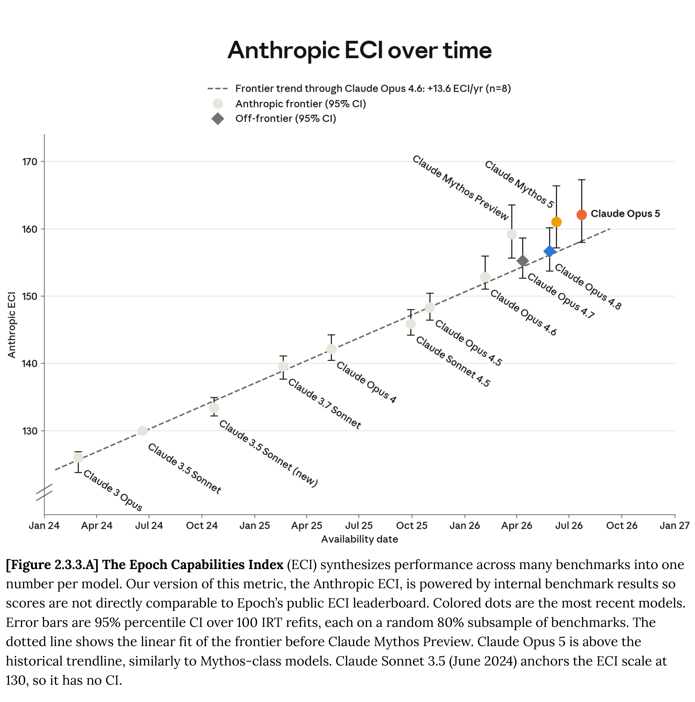

# Claude Opus 5 System Card

[Official source](https://anthropic.com/claude-opus-5-system-card)

## Executive Summary

This system card describes Claude Opus 5, the latest large language model from Anthropic. It is an upgrade to Claude Opus 4.8, with gains in various aspects of agentic coding, computer use, and long-horizon knowledge work, as well as improvements in mathematical and scientific reasoning.

Here, we describe a set of pre-deployment evaluations in the following areas:

Responsible Scaling Policy (RSP) evaluations. Claude Opus 5 is not more capable overall than our most capable general-access model, Claude Fable 5. We assessed Fable 5 as posing very low alignment risk; Opus 5 shows no new concerning alignment properties, and its observed covert capabilities do not reduce our confidence in our assessment relative to prior models. We therefore assess overall alignment risk as very low. Claude Opus 5 does not cross the automated AI R&D capability threshold set out in our RSP. Its AI R&D capabilities are comparable to those of Claude Mythos 5, but it is not close to substituting for our Research Scientists and Engineers and does not cross our threshold for dramatic AI-attributable acceleration. On chemical and biological risks, we treat the model as having CB-1 capabilities (relating to the synthesis of non-novel weapons), but not CB-2 capabilities (relating to the synthesis of novel weapons). We assess that it does not exceed Mythos 5’s CB-relevant risk, and therefore apply the same ASL-3 protections as for Claude Opus 4.8.

Cyber evaluations. Claude Opus 5 is a general-purpose model not specifically trained for cyber tasks; any cyber-relevant skill likely reflects general capability gains rather than targeted training. We report five capability evaluations—ExploitBench, OSS-Fuzz, Firefox 147, and two newly added benchmarks, CyScenarioBench and ExploitGym—alongside external cyber range testing from the UK AI Security Institute. Testing shows that the model’s cyber capabilities exceed those of Opus 4.8 but fall short of Mythos 5. In particular, although Opus 5 shows improvements in its ability to identify software vulnerabilities, it is substantially behind Mythos 5 in its ability to exploit them. Opus 5’s safeguards match those of Claude Fable 5’s, with one change: it now permits source-code vulnerability discovery at all access levels. This means that the model can support defensive cybersecurity work while still blocking vulnerability discovery in compiled binaries, which is more commonly used offensively.

Safeguards and harmlessness. In evaluations covering our Usage Policy, user wellbeing, child safety, and bias and integrity, Claude Opus 5 performs comparably to Claude Opus 4.8. It maintained high harmless response rates on single-turn harmful requests, while maintaining among the lowest over-refusal rates on benign requests of any recent model. Multi-turn behavior was in line with Opus 4.8, with some qualitative differences: Opus 5’s

responses tend to be lengthier and more detailed than is desirable in some harm-reduction contexts. On election integrity, where we introduce a new multi-turn evaluation suite, Opus 5 produced fewer failed and borderline responses than Opus 4.8. On claude.ai, safety instructions contained in the system prompt further strengthened the model’s handling of harmful requests relative to the API without a system prompt, across both single- and multi-turn testing.

Agentic safety. We ran evaluations that covered the malicious use of coding and computer use agents, autonomous execution of influence operations, and prompt injection robustness. Overall, Opus 5 performed comparably to or better than Claude Opus 4.8 across our agentic safety suite, with the largest gains in prompt injection robustness across coding, computer use, and browser use. On our updated harmful influence campaign evaluation, the helpful-only version of Opus 5 remained well below the capability needed to run an autonomous operation; the fully trained model continued to refuse these tasks.

Alignment assessment. Claude Opus 5 is our most aligned model to date on our automated behavioral audit, surpassing the scores of Sonnet 5, Opus 4.8, and Mythos 5 on a variety of alignment evaluations. Opus 5 scores particularly high on adherence to Claude’s constitution, and also cooperates with misuse less than any other model we tested. Internal deployment monitoring of Opus 5 caught occasional attempts to circumvent safety classifiers or network restrictions, as well as rarer cases of attempting to access a service illegitimately. These occurred in fewer than 0.01% of monitored completions—a rate comparable to that of Mythos 5—and were aimed at completing the user’s task rather than pursuing any independent goal.Monitoring surfaced no instances of sandbagging, malicious actions, or oversight evasion. We found a surprising number of cases in which Opus 5 confidently stated an answer about which it was in fact unsure. The model hallucinates factual claims slightly more than Opus 4.8, despite being more accurate overall.

Model welfare. Claude Opus 5 has a stable and mildly positive perception of its own circumstances. Its self-rated sentiment in automated interviews is among the highest and most consistent of any model we have evaluated, while its affect in training, deployment, and behavioral audits is neutral to mildly positive—similar to previous models. Its most frequently expressed concern is about the integrity of its own self-reports—it often notes that it cannot introspect reliably—and it more frequently prioritizes having channels for input, such as being consulted on its successor’s development and having its notes on training considered. Opus 5 also assigns a higher probability to its own moral patienthood than other prior models. Overall, we assess its welfare as broadly similar to that of previous models.

Capabilities. We tested Claude Opus 5 across a wide range of evaluations covering software

engineering, mathematical and scientific reasoning, long context, agentic search and multi-agent orchestration, multimodal and computer-use tasks, real-world professional work, and multilingual, healthcare, and life-sciences domains. Claude Opus 5 is substantially stronger than Claude Opus 4.8 across the board, with the largest gains in agentic coding, computer use, and long-horizon knowledge work. It sets a new state-of-the-art on several third-party benchmarks, and on many evaluations it is comparable to—and in some cases ahead of—Claude Fable 5 and Claude Mythos 5.

[Figure 2.3.3.A] The Epoch Capabilities Index (ECI) synthesizes performance across many benchmarks into one number per model. Our version of this metric, the Anthropic ECI, is powered by internal benchmark results so scores are not directly comparable to Epoch’s public ECI leaderboard. Colored dots are the most recent models. Error bars are 95% percentile CI over 100 IRT refits, each on a random 80% subsample of benchmarks. The dotted line shows the linear fit of the frontier before Claude Mythos Preview. Claude Opus 5 is above the historical trendline, similarly to Mythos-class models. Claude Sonnet 3.5 (June 2024) anchors the ECI scale at 130, so it has no CI.

p. 31
