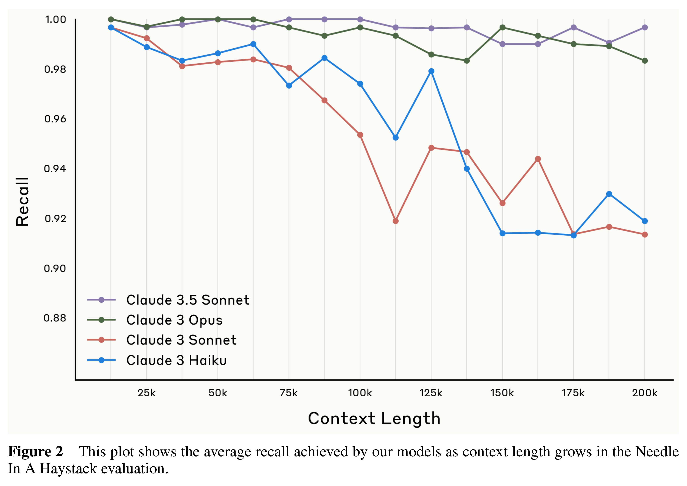

# Claude Sonnet 3.5 Model Card

[Official source](https://www.anthropic.com/system-cards)

## Introduction

This addendum to our Claude 3 Model Card describes Claude 3.5 Sonnet, a new model which outperforms our previous most capable model, Claude 3 Opus, while operating faster and at a lower cost. Claude 3.5 Sonnet offers improved capabilities, including better coding and visual processing. Since it is an evolution of the Claude 3 model family, we are providing an addendum rather than a new model card. We provide updated key evaluations and results from our safety testing.

Figure 2 This plot shows the average recall achieved by our models as context length grows in the Needle In A Haystack evaluation.

p. 4
