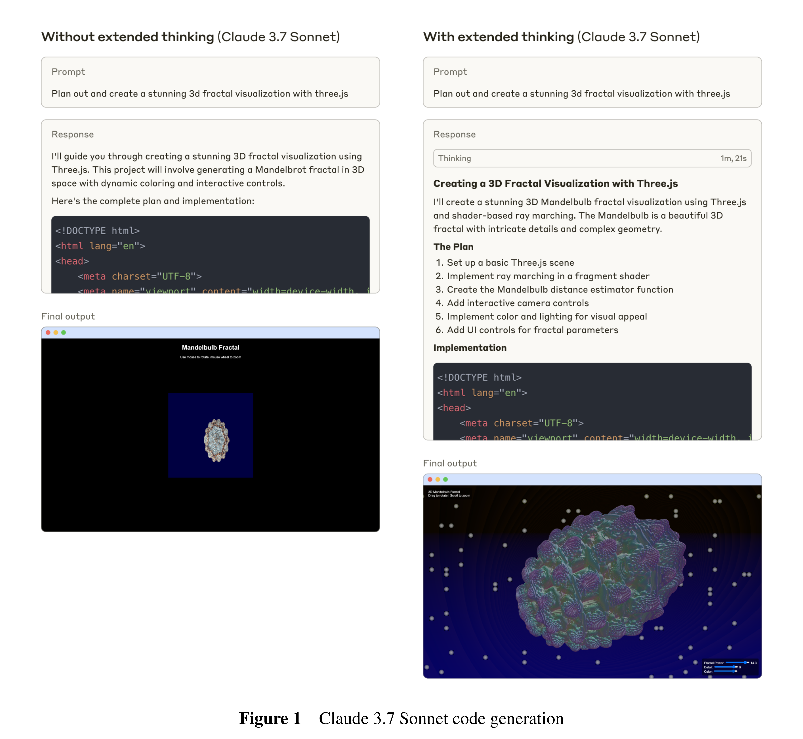

# Claude Sonnet 3.7 System Card

[Official source](https://www.anthropic.com/system-cards)

## Abstract

This system card introduces Claude 3.7 Sonnet, a hybrid reasoning model. We focus primarily on our measures and evaluations for reducing harms, both via model training and by leveraging surrounding safeguards systems and evaluations. We include an extensive analysis of evaluations based on our Responsible Scaling Policy [1], along with discussions of prompt injection risks for computer use, coding related risks, studies concerning the faithfulness of extended thinking and its implications, and reward hacking issues in agentic contexts. We also discuss work aimed at reducing refusal rates through non-harmful compliance, and evaluations for harms such as child safety.

Figure 1 Claude 3.7 Sonnet code generation

p. 4
