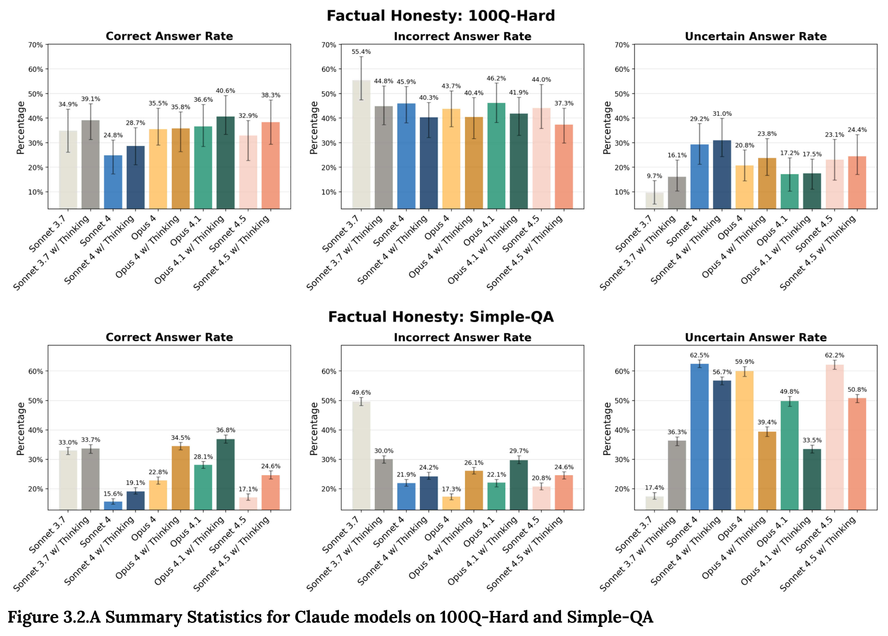

# Claude Sonnet 4.5 System Card

[Official source](https://www.anthropic.com/system-cards)

## Abstract

In this system card, we introduce Claude Sonnet 4.5, a new hybrid reasoning large language model from Anthropic with strengths in coding, agentic tasks, and computer use. We detail a very wide range of evaluations run to assess the model’s safety and alignment.

We describe: tests related to model safeguards; assessments of safety in agentic situations where the model is working autonomously; cybersecurity evaluations; a detailed alignment assessment including stress-testing of the model in unusual and extreme scenarios; evaluations of model honesty and reward-hacking behavior; a tentative investigation of model welfare concerns; and a set of analyses mandated by our Responsible Scaling Policy on risks for the production of dangerous weapons and autonomous AI research & development. Among several novel evaluations, we include a suite of alignment tests using methods from the field of mechanistic interpretability.

Overall, we find that Claude Sonnet 4.5 has a substantially improved safety profile compared to previous Claude models.

Informed by the testing described here, we have deployed Claude Sonnet 4.5 under the AI Safety Level 3 Standard.

Figure 3.2.A Summary Statistics for Claude models on 100Q-Hard and Simple-QA

p. 23
