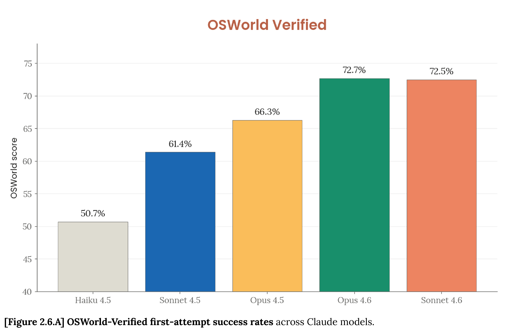

# Claude Sonnet 4.6 System Card

[Official source](https://anthropic.com/claude-sonnet-4-6-system-card)

## Abstract

Claude Sonnet 4.6 is the latest large language model from Anthropic. In this system card, we describe evaluations for its capabilities and its safety-related properties, and outline the reasoning behind its release under our Responsible Scaling Policy.

We evaluate the model for its coding, agentic, reasoning, multimodal, computer use, mathematical, and many other abilities, and assess its skills in specific areas such as finance, cybersecurity, and life sciences. We include an alignment assessment that addresses a very wide range of potentially misaligned behaviors and tests model behavior in unusual and extreme scenarios. We test the model’s safety during agentic use, and then describe evaluations of the model’s abilities in the domains explicitly covered by the Responsible Scaling Policy.

Capability evaluations found that Sonnet 4.6 substantially improves in a wide range of skills over its predecessor, Sonnet 4.5; in several evaluations, it approached or matched the capability levels of Claude Opus 4.6, our frontier model. In safety, too, Claude Sonnet 4.6 demonstrated improvements compared to the previous Sonnet model. Our conclusions about its safety profile were broadly comparable to those for Claude Opus 4.6: it shows low overall levels of misaligned behavior. On some measures, Sonnet 4.6 showed the best degree of alignment we have yet seen in any Claude model.

Informed by the testing described here—and similarly to Claude Sonnet 4.5—we have deployed Claude Sonnet 4.6 under the AI Safety Level 3 (ASL-3) Standard.

​[Figure 2.6.A] OSWorld-Verified first-attempt success rates​​across Claude models.​

p. 19
