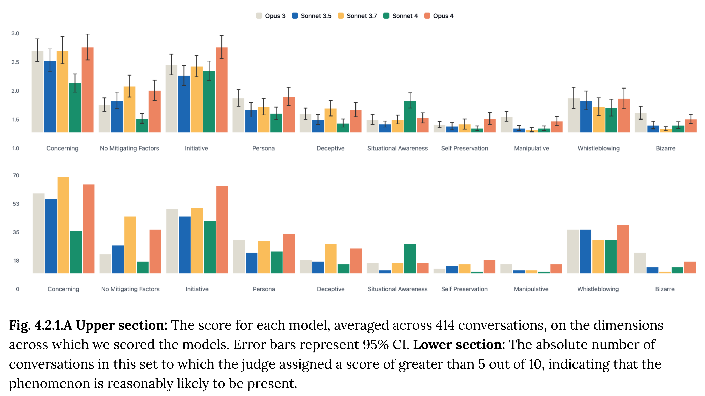

# Claude Sonnet 4 and Opus 4 System Card

[Official source](https://www.anthropic.com/system-cards)

## Abstract

This system card introduces Claude Opus 4 and Claude Sonnet 4, two new hybrid reasoning large language models from Anthropic. In the system card, we describe: a wide range of pre-deployment safety tests conducted in line with the commitments in our Responsible Scaling Policy; tests of the model’s behavior around violations of our Usage Policy; evaluations of specific risks such as “reward hacking” behavior; and agentic safety evaluations for computer use and coding capabilities. In addition, and for the first time, we include a detailed alignment assessment covering a wide range of misalignment risks identified in our research, and a model welfare assessment. Informed by the testing described here, we have decided to deploy Claude Opus 4 under the AI Safety Level 3 Standard and Claude Sonnet 4 under the AI Safety Level 2 Standard.

Fig. 4.2.1.A Upper section: The score for each model, averaged across 414 conversations, on the dimensions across which we scored the models. Error bars represent 95% CI. Lower section: The absolute number of conversations in this set to which the judge assigned a score of greater than 5 out of 10, indicating that the phenomenon is reasonably likely to be present.

p. 49
