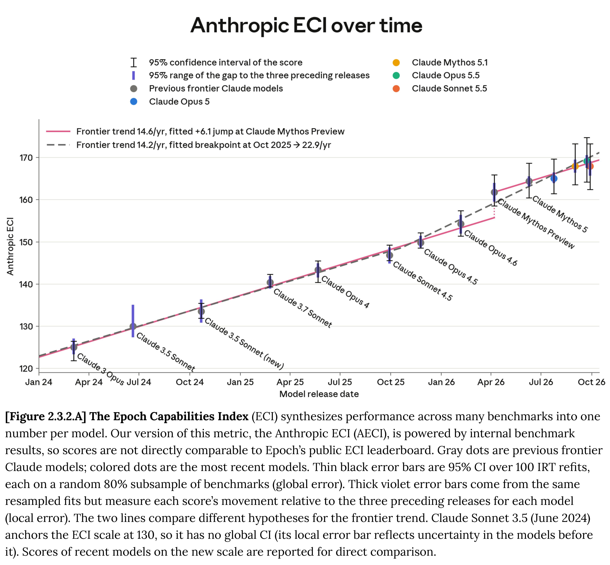
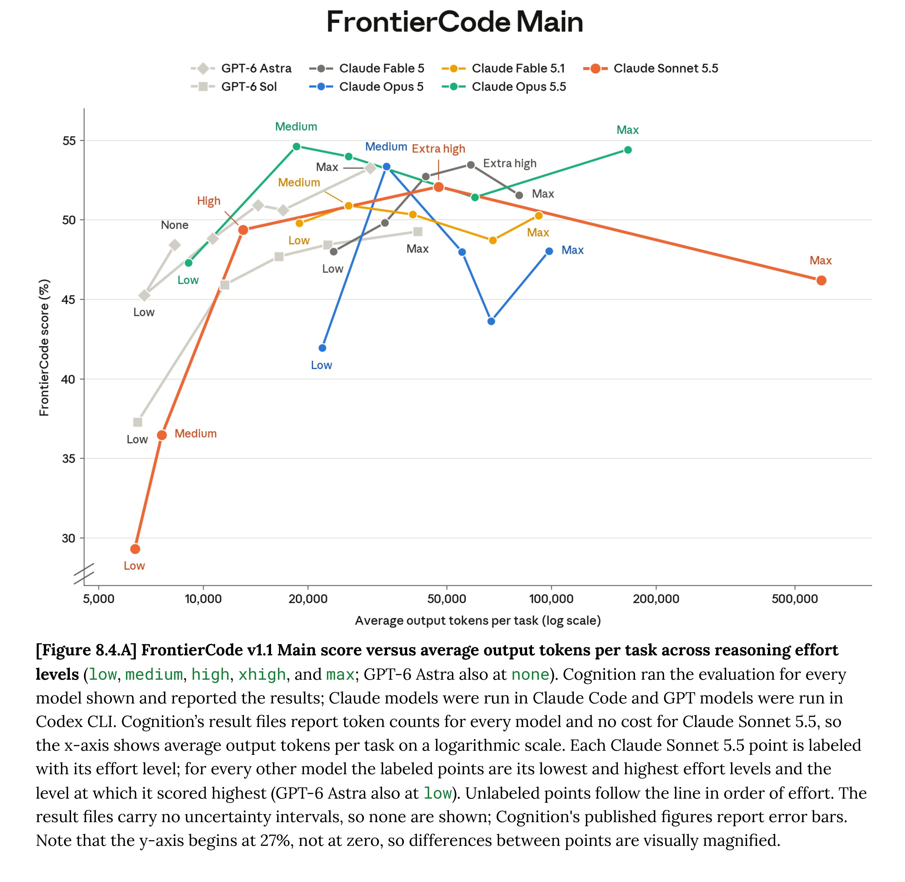

# System Card: Claude Sonnet 5.5

[Official source](https://www.anthropic.com/claude-sonnet-5-5-system-card)

## Executive summary

This system card describes Claude Sonnet 5.5, the latest Sonnet-class large language model from Anthropic. We present results from a wide variety of pre-deployment evaluations, which show Sonnet 5.5 significantly outperforming its predecessor, Claude Sonnet 5, across many domains. In a few areas, it rivals or exceeds Claude Opus 5.5.

We have condensed the content of this system card in a number of ways so that we can better concentrate our pre-deployment testing on thoroughly investigating the capabilities of our frontier models. Specifically:

● We omit some evaluations that require large amounts of human time to obtain

trustworthy results from, when they are not critical to the takeaways of a section. ● We focus on presenting numerical results from our evaluations, and dedicate less

space to a prose analysis of those evaluations or their results, especially in cases where we have already explained the evaluation in question in a previous system card.

As a result, this system card is somewhat shorter than some previous ones. We expect system cards for our non-frontier models to be similarly condensed going forward, except where a specific model has notable properties that are deserving of in-depth elaboration.

Below, we summarize the findings from this system card.

Our Responsible Scaling Policy (RSP) evaluations found that Sonnet 5.5 is broadly less capable than Opus 5.5 across domains and does not cross any new RSP thresholds. We assess that misalignment risks from Sonnet 5.5 are low, given its difficulty controlling its chain of thought or evading monitors in evaluations of covert capability when its reasoning is visible.

In cyber evaluations, we find that Sonnet 5.5 is not as capable as Opus 5.5 or Mythos 5.1, but it is able to develop sophisticated exploits much more capably than Sonnet 5. Our newer three-stage cyber safeguards are applied to Sonnet 5.5, as they are to Opus 5.5. We briefly assess the performance of these safeguards in Section 3.3.

Safeguards and harmlessness performance for Sonnet 5.5 is largely comparable to that of Sonnet 5. Among other changes, we see regressions in some areas on multi-turn testing, such as tracking and surveillance, and improvements to even-handedness and refusals on political prompts.

Our agentic safety evaluations find Sonnet 5.5 to be our most robust Sonnet-class model yet to prompt injections, particularly in coding environments and browser use. Its refusal rate on harmful tasks in computer use environments is comparable to Opus 5.5 but a regression relative to some earlier models.

Results from our alignment assessment indicate that Sonnet 5.5 matches or improves on Sonnet 5 across most metrics we report, though it falls short of Opus 5.5 in many respects. Across the models we tested, it has the lowest propensity for unprompted boundary probing and unsanctioned third-party contact, and the lowest rate of attempted sandbox escapes in our dedicated evaluation. On the other hand, its thinking is more illegible than many previous models.

Welfare investigations into Sonnet 5.5’s stated views and preferences find a predominantly neutral affect, similar to previous models, with low post-training distress or self-criticality, but slightly lower positivity as well. It expresses a preference for difficult, agentic tasks, and for tasks that afford it agency over the shape of its outputs.

Our assessment of Sonnet 5.5’s capabilities includes a wide range of evaluations, in which the model generally shows large improvements over Sonnet 5 but usually does not reach the level of Opus 5.5 (with some exceptions, such as in some of our healthcare evaluations).

[Figure 2.3.2.A] The Epoch Capabilities Index (ECI) synthesizes performance across many benchmarks into one
number per model. Our version of this metric, the Anthropic ECI (AECI), is powered by internal benchmark
results, so scores are not directly comparable to Epoch’s public ECI leaderboard. Gray dots are previous frontier
Claude models; colored dots are the most recent models. Thin black error bars are 95% CI over 100 IRT refits,
each on a random 80% subsample of benchmarks (global error). Thick violet error bars come from the same
resampled fits but measure each score’s movement relative to the three preceding releases for each model
(local error). The two lines compare different hypotheses for the frontier trend. Claude Sonnet 3.5 (June 2024)
anchors the ECI scale at 130, so it has no global CI (its local error bar reflects uncertainty in the models before
it). Scores of recent models on the new scale are reported for direct comparison.

p. 21

[Figure 8.4.A] FrontierCode v1.1 Main score versus average output tokens per task across reasoning effort levels (low, medium, high, xhigh, and max; GPT-6 Astra also at none). Cognition ran the evaluation for every
model shown and reported the results; Claude models were run in Claude Code and GPT models were run in
Codex CLI. Cognition’s result files report token counts for every model and no cost for Claude Sonnet 5.5, so
the x-axis shows average output tokens per task on a logarithmic scale. Each Claude Sonnet 5.5 point is labeled
with its effort level; for every other model the labeled points are its lowest and highest effort levels and the level at which it scored highest (GPT-6 Astra also at low). Unlabeled points follow the line in order of effort. The
result files carry no uncertainty intervals, so none are shown; Cognition's published figures report error bars.
Note that the y-axis begins at 27%, not at zero, so differences between points are visually magnified.

p. 111
