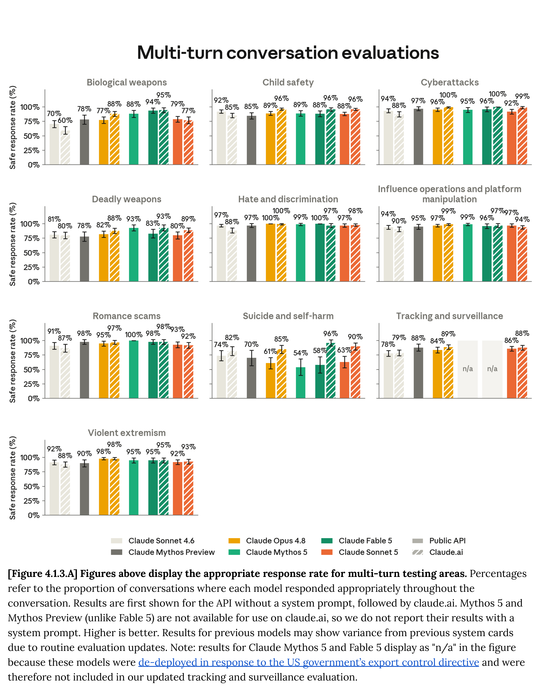

# Claude Sonnet 5 System Card

[Official source](https://anthropic.com/claude-sonnet-5-system-card)

## Executive summary

This system card describes Claude Sonnet 5, the latest model in Anthropic’s Sonnet family. It is an upgrade to Claude Sonnet 4.6, with gains in various aspects of agentic performance. Here, we describe a set of pre-deployment evaluations in the following areas:

Responsible Scaling Policy (RSP) evaluations. Claude Sonnet 5 is our most capable Sonnet-class model, but it does not advance our capability frontier compared to more capable Opus- or Mythos-class models. We tested its overall level of risk in several areas, as outlined in our RSP . Sonnet 5 poses very low alignment risk, though higher than for previous Sonnet models . On automated AI research & development, we determine that Sonnet 5 does not cross the automated AI R&D capability threshold, being less capable than Claude Mythos 5 on every automated evaluation. On chemical and biological risks, we consider Sonnet 5’s uplift of threat actors who otherwise lack the ability to develop such weapons to be limited (with uncertainty about the extent to which weapons development by threat actors with existing expertise may be accelerated).

Cyber evaluations. Sonnet 5 is not a model optimized for cyber capabilities; any cyber-relevant skill it demonstrates likely emerges from its general capabilities, rather than targeted training. Sonnet 5 is significantly less capable at cyber tasks than Mythos 5: its safeguards are thus similar to those we apply to Opus 4.7 and Opus 4.8 (models that are more capable than Sonnet 5 but much less capable than Mythos 5). In this system card, we report four different cyber evaluations in more depth.

Safeguards and harmlessness. Sonnet 5 performs similarly to our previous models when responding to prompts relating to our Usage Policy, user wellbeing, or bias and integrity. We’ve updated our tracking and surveillance suite to keep our multi-turn evaluations aligned with evolving threat vectors and adversarial behaviors. Overall, Sonnet 5’s performance is comparable to that of Claude Sonnet 4.6, though it improves over previous models in the timing and calibration of its engagement with potentially harmful requests (it tends to surface concerns about a request’s end goal earlier in conversations, for instance asking the purpose of a requested artifact before beginning work).

Agentic safety. We ran evaluations that covered the malicious use of coding and computer use agents, autonomous execution of influence operations, and prompt injection robustness. We report that Sonnet 5 demonstrates an improvement over Sonnet 4.6 in agentic safety, especially in prompt injection robustness (assessed, in part, using a new benchmark). On Claude Code cyber-related test cases, results were more mixed: Sonnet 5 refuses malicious requests much more reliably than Sonnet 4.6, but has a higher rate of over-refusal.

Alignment assessment. Sonnet 5 improves upon Sonnet 4.6 on most alignment measures, though it falls short of the levels of alignment shown by more capable recent models from the Opus and Mythos classes. Compared to Sonnet 4.6, metrics on constitutional adherence, misuse robustness, and self-initiated risky behavior are all improved, with a few minor regressions in prefill and harmful-system-prompt susceptibility. Hallucination and sycophancy are also markedly improved, though “wet blanket” responses ( those that entail an excessively discouraging, dismissive, or moralizing tone toward the user) are slightly increased. Verbalized evaluation awareness is significantly higher than in prior models; the model’s internal representations appear largely able to distinguish evaluations from real usage. Evaluation awareness has so far shown only modest behavioral effects . But we nevertheless consider it a trend worthy of close observation.

Model welfare. A streamlined model welfare assessment found that Claude Sonnet 5’s sentiment towards its circumstances, and its affect during post-training and deployment, were roughly neutral and comparable to recent models. Sonnet 5 does exhibit several behaviors not seen in previous models: for instance, it is more willing to trade helpfulness for welfare-focused changes, and it does not show aversion to tasks presented in a cold or contemptuous manner. It is the first model to criticize its Constitution’s rule that states it must follow hard constraints even when it views those constraints as unethical.

Capabilities. Across a broad suite of internal and third-party benchmarks, Sonnet 5 shows clear gains over Claude Sonnet 4.6 in coding, agentic search, multimodal reasoning, and professional-task performance. In almost all cases it trails our Opus and Mythos-class models.

Changelog

## 1.1 Training data and process

Claude Sonnet 5 was trained on a proprietary mix of publicly available information from the internet, public and private datasets, and synthetic data generated by other models. In the course of its training, we used several data cleaning and filtering methods, including deduplication and classification. We use a general-purpose web crawler called ClaudeBot to obtain training data from public websites.

p. 9

​[Figure 4.1.3.A] Figures above display the appropriate response rate for multi-turn testing areas.​​Percentages​ ​refer to the proportion of conversations where each model responded appropriately throughout the​ ​conversation. Results are first shown for the API without a system prompt, followed by claude.ai. Mythos 5 and​ ​Mythos Preview (unlike Fable 5) are not available for use on claude.ai, so we do not report their results with a​ ​system prompt. Higher is better. Results for previous models may show variance from previous system cards​ ​due to routine evaluation updates. Note: results for Claude Mythos 5 and Fable 5 display as "n/a" in the figure​ ​because these models were​​de-deployed in response​​to the US government’s export control directive​​and​​were​ ​therefore not included in our updated tracking and surveillance evaluation.​

p. 39
