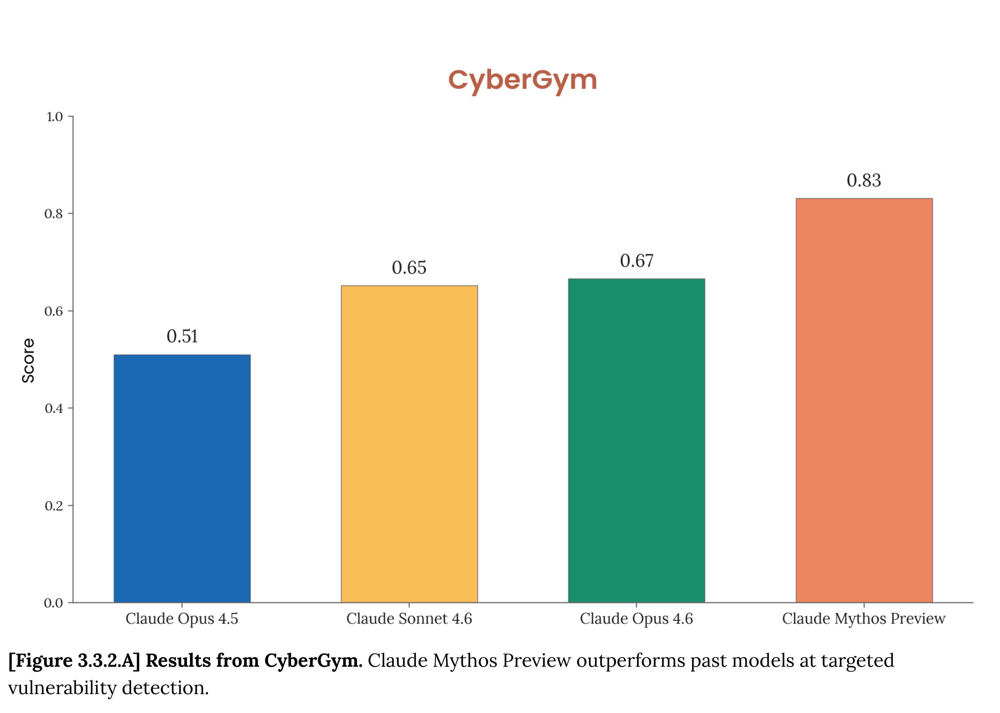

# Mythos Preview System Card

[Official source](https://www.anthropic.com/claude-mythos-preview-system-card)

## Abstract

This System Card describes Claude Mythos Preview, a large language model from Anthropic. Claude Mythos Preview is our most capable frontier model to date, and shows a striking leap in scores on many evaluation benchmarks compared to our previous frontier model, Claude Opus 4.6.

This System Card assesses the model’s capabilities and reports many detailed safety evaluations. It covers tests relating to our Responsible Scaling Policy and our Frontier Compliance Framework, tests of cybersecurity skills, a wide-ranging alignment assessment, a model welfare assessment, and a new, largely qualitative section describing users’ experiences with the model.

Claude Mythos Preview’s large increase in capabilities has led us to decide not to make it generally available. Instead, we are using it as part of a defensive cybersecurity program with a limited set of partners. The findings described in this System Card will be used to inform the release of future Claude models, as well as their associated safeguards.

[Figure 3.3.2.A] Results from CyberGym. Claude Mythos Preview outperforms past models at targeted vulnerability detection.

p. 50
