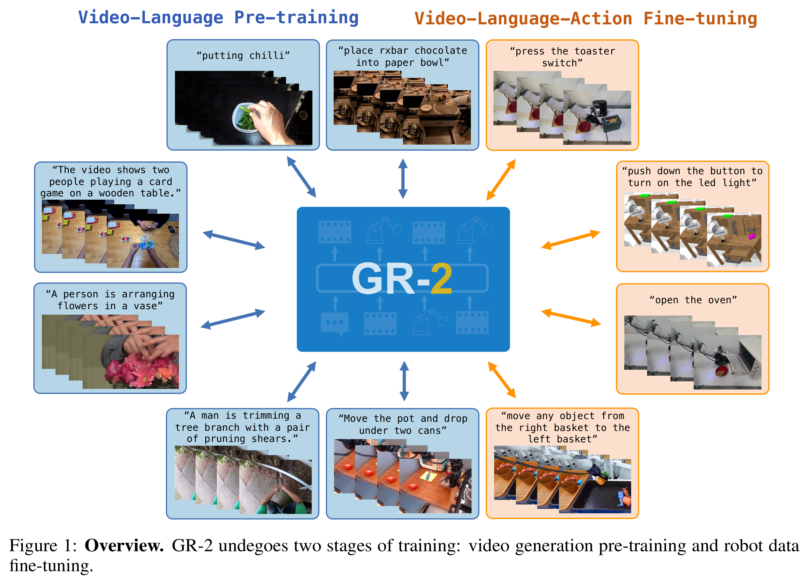
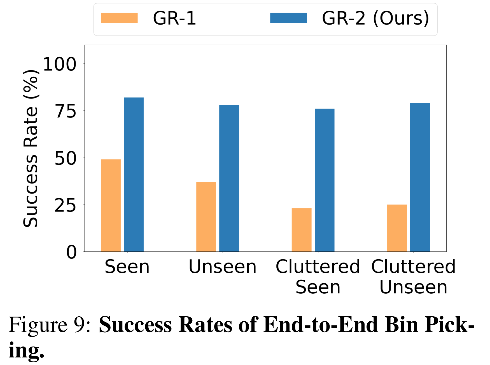

# GR-2: A Generative Video-Language-Action Model with Web-Scale Knowledge for Robot Manipulation

[Official source](https://arxiv.org/abs/2410.06158)

## Abstract

We present GR-2, a state-of-the-art generalist robot agent for versatile and generalizable robot manipulation. GR-2 is first pre-trained on a vast number of Internet videos to capture the dynamics of the world. This large-scale pre-training, involving 38 million video clips and over 50 billion tokens, equips GR-2 with the ability to generalize across a wide range of robotic tasks and environments during subsequent policy learning. Following this, GR-2 is fine-tuned for both video generation and action prediction using robot trajectories. It exhibits impressive multi-task learning capabilities, achieving an average success rate of 97.7% across more than 100 tasks. Moreover, GR-2 demonstrates exceptional generalization to new, previously unseen scenarios, including novel backgrounds, environments, objects, and tasks. Notably, GR-2 scales effectively with model size, underscoring its potential for continued growth and application. Project page: https://gr2-manipulation.github.io.

Figure 1: Overview. GR-2 undegoes two stages of training: video generation pre-training and robot data fine-tuning.

p. 2

Figure 9: Success Rates of End-to-End Bin Pick- ing.

p. 8
