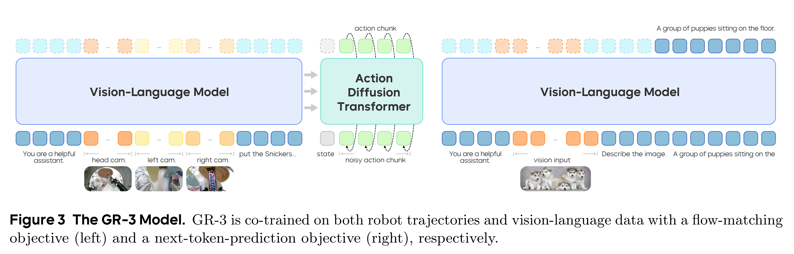
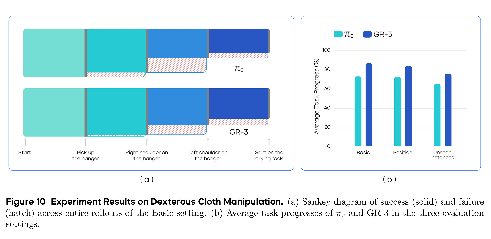

# GR-3 Technical Report

[Official source](https://arxiv.org/abs/2507.15493)

## Abstract

We report our recent progress towards building generalist robot policies, the development of GR-3. GR-3 is a large-scale vision-language-action (VLA) model. It showcases exceptional capabilities in generalizing to novel objects, environments, and instructions involving abstract concepts. Furthermore, it can be efficiently fine-tuned with minimal human trajectory data, enabling rapid and cost-effective adaptation to new settings. GR-3 also excels in handling long-horizon and dexterous tasks, including those requiring bi-manual manipulation and mobile movement, showcasing robust and reliable performance. These capabilities are achieved through a multi-faceted training recipe that includes co-training with web-scale vision-language data, efficient fine-tuning from human trajectory data collected via VR devices, and effective imitation learning with robot trajectory data. In addition, we introduce ByteMini, a versatile bi-manual mobile robot designed with exceptional flexibility and reliability, capable of accomplishing a wide range of tasks when integrated with GR-3. Through extensive real-world experiments, we show GR-3 surpasses the state-of-the-art baseline method, π0, on a wide variety of challenging tasks. We hope GR-3 can serve as a step towards building generalist robots capable of assisting humans in daily life.

Figure 3 The GR-3 Model. GR-3 is co-trained on both robot trajectories and vision-language data with a flow-matching objective (left) and a next-token-prediction objective (right), respectively.

p. 4

Figure 10 Experiment Results on Dexterous Cloth Manipulation. (a) Sankey diagram of success (solid) and failure (hatch) across entire rollouts of the Basic setting. (b) Average task progresses of π0 and GR-3 in the three evaluation settings.

p. 13
