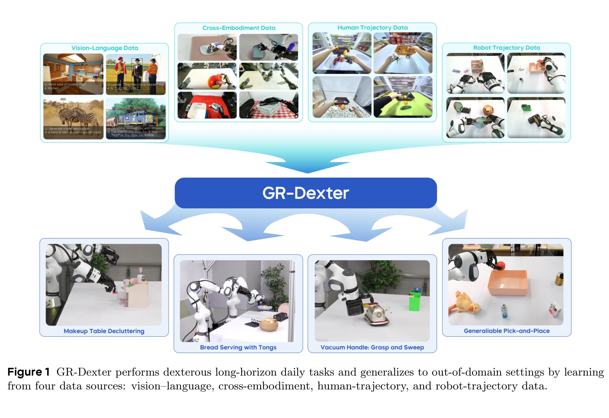
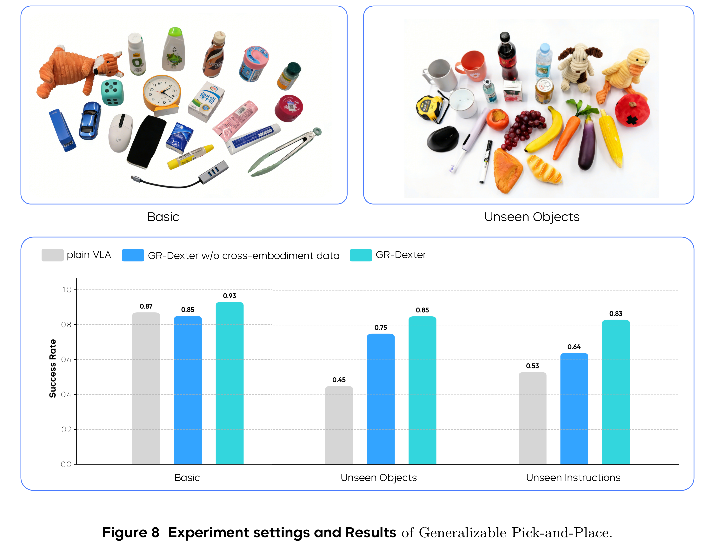

# GR-Dexter Technical Report

[Official source](https://arxiv.org/abs/2512.24210)

## Abstract

Vision-language-action (VLA) models have enabled language-conditioned, long-horizon robot manipulation, but most existing systems are limited to grippers. Scaling VLA policies to bimanual robots with high degree-of-freedom (DoF) dexterous hands remains challenging due to the expanded action space, frequent hand-object occlusions, and the cost of collecting real-robot data. We present GR-Dexter, a holistic hardware-model-data framework for VLA-based generalist manipulation on a bimanual dexterous-hand robot. Our approach combines the design of a compact 21-DoF robotic hand, an intuitive bimanual teleoperation system for real-robot data collection, and a training recipe that leverages teleoperated robot trajectories together with large-scale vision-language and carefully curated cross-embodiment datasets. Across real-world evaluations spanning long-horizon everyday manipulation and generalizable pick-and-place, GR-Dexter achieves strong in-domain performance and improved robustness to unseen objects and unseen instructions. We hope GR-Dexter serves as a practical step toward generalist dexterous-hand robotic manipulation.

Figure 1 GR-Dexter performs dexterous long-horizon daily tasks and generalizes to out-of-domain settings by learning from four data sources: vision–language, cross-embodiment, human-trajectory, and robot-trajectory data.

p. 2

Figure 8 Experiment settings and Results of Generalizable Pick-and-Place.

p. 9
