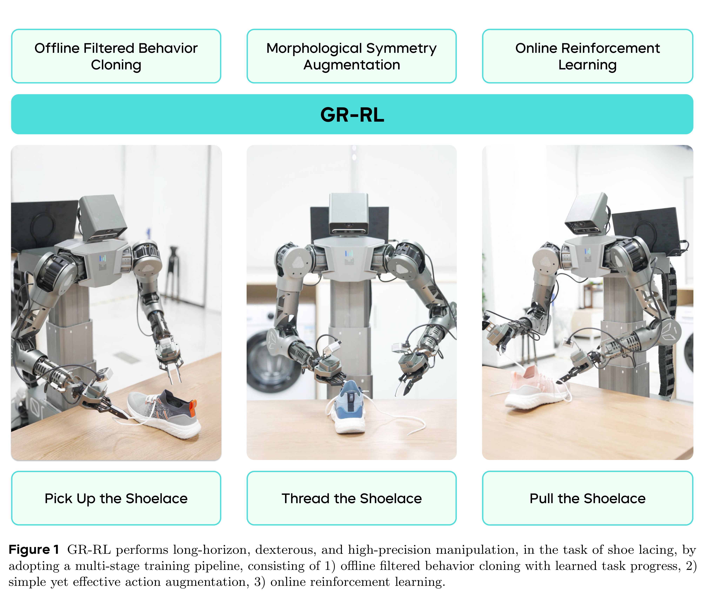
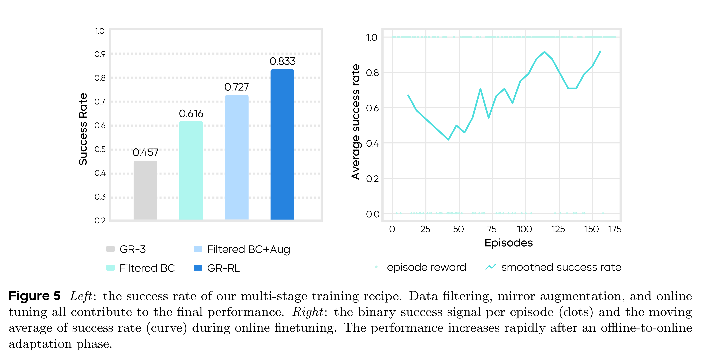

# GR-RL: Going Dexterous and Precise for Long-Horizon Robotic Manipulation

[Official source](https://arxiv.org/abs/2512.01801)

## Abstract

We present GR-RL, a robotic learning framework that turns a generalist vision-language-action (VLA) policy into a highly capable specialist for long-horizon dexterous manipulation. Assuming the optimality of human demonstrations is core to existing VLA policies. However, we claim that in highly dexterous and precise manipulation tasks, human demonstrations are noisy and suboptimal. GR-RL proposes a multi-stage training pipeline that filters, augments, and reinforces the demonstrations by reinforcement learning. First, GR-RL learns a vision-language-conditioned task progress, filters the demonstration trajectories, and only keeps the transitions that contribute positively to the progress. Specifically, we show that by directly applying offline RL with sparse reward, the resulting Q-values can be treated as a robust progress function. Next, we introduce morphological symmetry augmentation that greatly improves the generalization and performance of GR-RL. Lastly, to better align the VLA policy with its deployment behaviors for high-precision control, we perform online RL by learning a latent space noise predictor. With this pipeline, GR-RL is—to our knowledge—the first learning-based policy that can autonomously lace up a shoe by threading shoelaces through multiple eyelets with an 83.3% success rate, a task requiring long-horizon reasoning, millimeter-level precision, and compliant soft-body interaction. We hope GR-RL provides a step toward enabling generalist robot foundation models to specialize into reliable real-world experts.

Figure 1 GR-RL performs long-horizon, dexterous, and high-precision manipulation, in the task of shoe lacing, by adopting a multi-stage training pipeline, consisting of 1) offline filtered behavior cloning with learned task progress, 2) simple yet effective action augmentation, 3) online reinforcement learning.

p. 2

Figure 5 Left: the success rate of our multi-stage training recipe. Data filtering, mirror augmentation, and online tuning all contribute to the final performance. Right: the binary success signal per episode (dots) and the moving average of success rate (curve) during online finetuning. The performance increases rapidly after an offline-to-online adaptation phase.

p. 8
