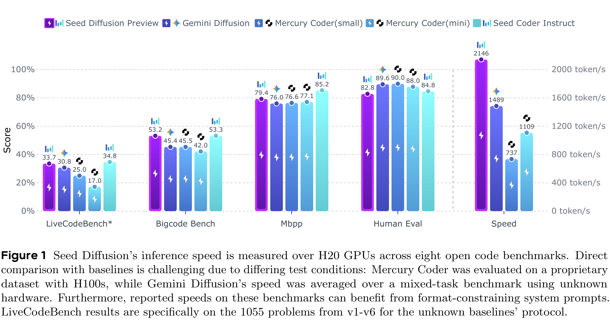

# Seed Diffusion: A Large-Scale Diffusion Language Model with High-Speed Inference

[Official source](https://seed.bytedance.com/en/seed_model_portfolio)

## Abstract

We present Seed Diffusion Preview, a large-scale language model based on discrete-state diffusion, offering remarkably fast inference speed. Thanks to non-sequential, parallel generation, discrete diffusion models provide a notable speedup to mitigate the inherent latency of token-by-token decoding, as demonstrated recently (e.g., Mercury Coder [1], Gemini Diffusion [2]). Seed Diffusion Preview achieves an inference speed of 2,146 token/s over H20 GPUs while maintaining competitive performance across a sweep of standard code evaluation benchmarks, significantly faster than contemporary Mercury and Gemini, establishing new state of the art on the speed-quality Pareto frontier for code models. Demo is available at https://studio.seed.ai/exp/seed_diffusion/.

Figure 1 Seed Diffusion’s inference speed is measured over H20 GPUs across eight open code benchmarks. Direct comparison with baselines is challenging due to differing test conditions: Mercury Coder was evaluated on a proprietary dataset with H100s, while Gemini Diffusion’s speed was averaged over a mixed-task benchmark using unknown hardware. Furthermore, reported speeds on these benchmarks can benefit from format-constraining system prompts. LiveCodeBench results are specifically on the 1055 problems from v1-v6 for the unknown baselines’ protocol.

p. 1
