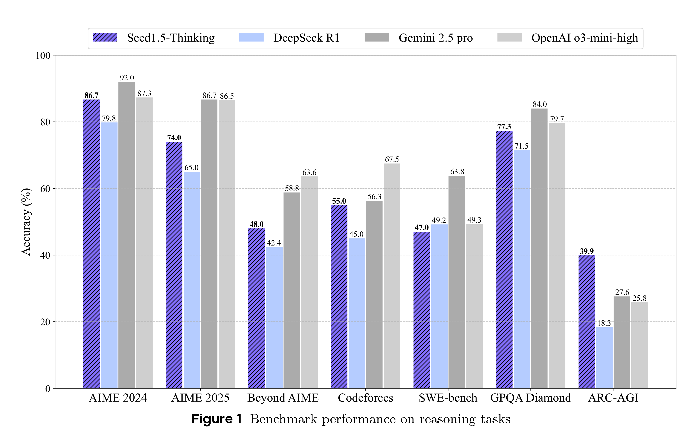

# Seed1.5-Thinking: Advancing Superb Reasoning Models with Reinforcement Learning

[Official source](https://github.com/ByteDance-Seed/Seed-Thinking-v1.5)

## Abstract

We introduce Seed1.5-Thinking, capable of reasoning through thinking before responding, resulting in improved performance on a wide range of benchmarks. Seed1.5-Thinking achieves 86.7 on AIME 2024, 55.0 on Codeforces and 77.3 on GPQA, demonstrating excellent reasoning abilities in STEM and coding. Beyond reasoning tasks, the method demonstrates notable generalization across diverse domains. For instance, it surpasses DeepSeek R1 by 8% in win rate on non-reasoning tasks, indicating its broader applicability. Compared to other state-of-the-art reasoning models, Seed1.5-Thinking is a Mixture-of-Experts (MoE) model with a relatively small size, featuring 20B activated and 200B total parameters. As part of our effort to assess generalized reasoning, we develop two internal benchmarks, BeyondAIME and Codeforces, both of which will be publicly released to support future research. Model trial link: https://www.volcengine.com/experience/ark.

Figure 1 Benchmark performance on reasoning tasks

p. 1
