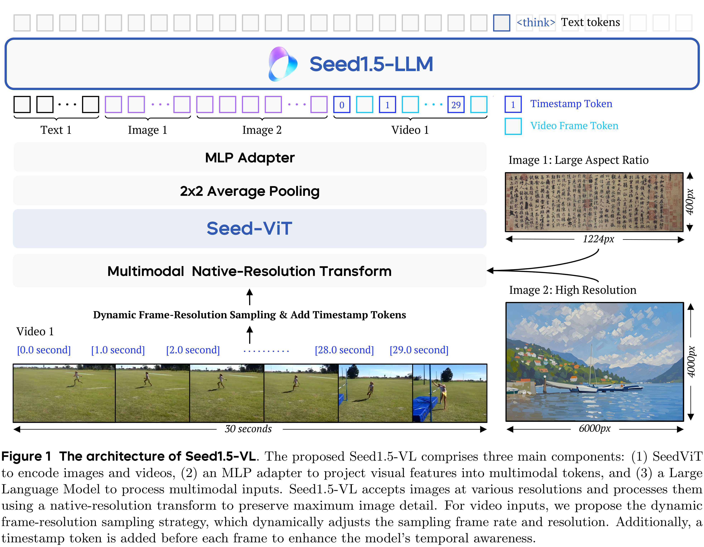

# Seed1.5-VL Technical Report

[Official source](https://seed.bytedance.com/en/seed_model_portfolio)

## Abstract

We present Seed1.5-VL, a vision-language foundation model designed to advance general-purpose multimodal understanding and reasoning. Seed1.5-VL is composed with a 532M-parameter vision encoder and a Mixture-of-Experts (MoE) LLM of 20B active parameters. Despite its relatively compact architecture, it delivers strong performance across a wide spectrum of public VLM benchmarks and internal evaluation suites, achieving the state-of-the-art performance on 38 out of 60 public benchmarks. Moreover, in agent-centric tasks such as GUI control and gameplay, Seed1.5-VL outperforms leading multimodal systems, including OpenAI CUA and Claude 3.7. Beyond visual and video understanding, it also demonstrates strong reasoning abilities, making it particularly effective for multimodal reasoning challenges such as visual puzzles. We believe these capabilities will empower broader applications across diverse tasks. In this report, we mainly provide a comprehensive review of our experiences in building Seed1.5-VL across model design, data construction, and training at various stages, hoping that this report can inspire further research. Seed1.5-VL is now accessible on Volcano Enginea.

Figure 1 The architecture of Seed1.5-VL. The proposed Seed1.5-VL comprises three main components: (1) SeedViT to encode images and videos, (2) an MLP adapter to project visual features into multimodal tokens, and (3) a Large Language Model to process multimodal inputs. Seed1.5-VL accepts images at various resolutions and processes them using a native-resolution transform to preserve maximum image detail. For video inputs, we propose the dynamic frame-resolution sampling strategy, which dynamically adjusts the sampling frame rate and resolution. Additionally, a timestamp token is added before each frame to enhance the model’s temporal awareness.

p. 5
