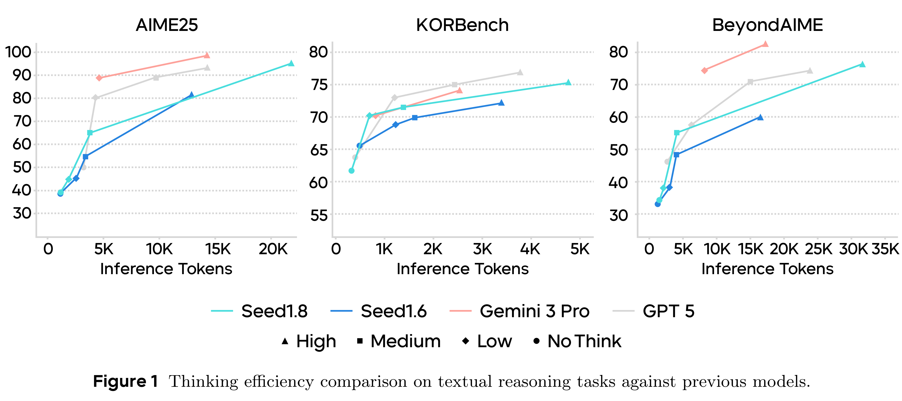

# Seed1.8 Model Card: Towards Generalized Real-World Agency

[Official source](https://seed.bytedance.com/en/seed_model_portfolio)

## Introduction

Recent progress in large language models (LLMs) and vision–language models (VLMs) has enabled strong performance on foundational capabilities, including natural language understanding, reasoning, code generation, and multimodal perception. These capabilities provide a general substrate for interpreting user intent and producing structured outputs. However, many real-world applications require models to go beyond single-turn prediction and operate in interactive settings that involve tool use, environment feedback, and multi-step task execution.

Seed1.8 is developed to support generalized real-world agency. The model is designed to retain core LLM and VLM capabilities while extending them toward multi-turn interaction and task execution. Rather than introducing task-specific agent pipelines, Seed1.8 emphasizes integration of perception, reasoning, and action within a single model. The design of Seed1.8 is guided by the following considerations:

• Strong Base Capabilities. Seed1.8 maintains competitive performance on standard LLM and VLM benchmarks, including reasoning, complex instruction following, knowledge coverage, and multimodal understanding. These capabilities provide the foundation for downstream agentic behavior.

• Unified Agentic Interaction and Multi-Step Execution. Seed1.8 supports search, code generation and execution, and graphical user interface (GUI) interaction within a unified agentic interface. The model is designed to perform iterative decision making over multiple steps, where intermediate results from retrieval, code execution, and environment interaction inform subsequent actions. Search capabilities enable information gathering and evidence synthesis from external sources, while code-centric execution supports structured computation, program modification, and tool orchestration. Native visual perception further allows the model to interpret and interact with visual interfaces—such as screenshots, documents, charts, and videos—enabling direct operation in software environments when programmatic APIs are unavailable.

• Latency- and Cost-Aware Inference. Interactive deployment introduces constraints on response time and computational overhead, particularly for multimodal and long-context inputs. Seed1.8 provides configurable thinking modes to balance inference depth and latency, and incorporates optimized visual encoding to reduce token consumption for image and video inputs.

• Evaluation Aligned with Practical Use. Model development and validation are guided by a combination of public benchmarks and internal evaluations derived from high-value application domains. These evaluations span foundational capabilities, multimodal understanding, and agentic workflows, enabling assessment across a range of realistic usage patterns.

In the remainder of this report, we present a detailed evaluation covering foundational LLM and VLM capabilities, agentic performance, and efficiency in both public benchmarks and real-world-inspired workflows.

Figure 1 Thinking efficiency comparison on textual reasoning tasks against previous models.

p. 9
