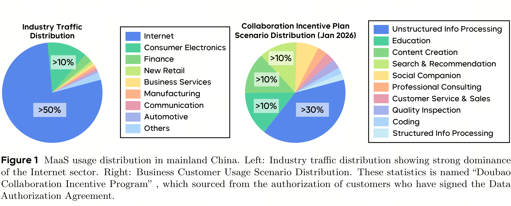

# Seed2.0 Model Card: Towards Intelligence Frontier for Real-World Complexity

[Official source](https://seed.bytedance.com/en/seed_model_portfolio)

## Introduction

Large Language Models (LLMs) now play a central role in modern digital infrastructure. Usage has grown dramatically across both professional and personal contexts [11]. The Seed team has developed a comprehensive model family that includes general-purpose LLMs, multimodal models, open-source releases, code-specialized models, diffusion-based language modeling, formal theorem proving, and generative media systems: Seed1.6/1.8, Seed1.5-VL, Seed-OSS, Seed-Coder, Seed Diffusion, and Seed-Prover. These models currently power a large-scale product ecosystem serving hundreds of millions of daily active users across applications. Meanwhile, the field is moving toward an agentic paradigm where LLMs tackle scientific research, complex software development, autonomous documentation learning, and multi-step real-world workflows. This shift motivates Seed2.0 Series (Pro / Lite / Mini), which is designed to deliver optimal user experience in large-scale production environments.

Seed2.0 prioritizes user experience under large-scale online deployment, as evidenced by strong results on the LMSYS Chatbot Arena, a public human preference benchmark. 1 In practice, interactive quality is most directly shaped by four factors: the prevalence of visual and multimodal queries, the impact of inference latency on user satisfaction, the need for reliable complex instruction execution, and the demand for seamless coding assistance. Our design reflects these priorities:

• Robust Visual and Multimodal Understanding. A substantial fraction of real user queries involve images—screenshots, charts, scanned documents, and mixed-media content. Seed2.0 strengthens visual reasoning with reduced hallucination [20, 35, 117] and improves structured extraction from documents and figures [65, 100].

• Fast and Flexible Inference. Inference latency directly impacts user experience. Seed2.0 offers three model sizes (Pro / Lite / Mini), allowing developers to choose the appropriate balance between performance and speed for their specific use case.

• Reliable Complex Instruction Execution. In production, we observe that users frequently issue complex, multi-step instructions that require precise execution—tasks where success depends not on factual recall but on structured reasoning and constraint satisfaction. Recent benchmarks such as DeR2 [115] and CL-bench [26] capture exactly this demand. Seed2.0 treats it as a first-class requirement.

Seed2.0 also pursues a broader goal: handling tasks with real-world complexity. The Seed team has focused on raising the intelligence ceiling, moving from Olympiad-style problems toward research-level reasoning tasks. Seed2.0 tackles Erdos problems and performs Scientific Coding, pushing the boundaries of machine intelligence [4, 8, 70, 76].

Current agent systems, however, show an interesting asymmetry: they solve competition-level problems yet often fail to reliably complete practical tasks end-to-end—like building a well-designed application in one pass [17]. Two factors explain this gap. First, real-world tasks span long horizons and multiple stages, but

Figure 1 MaaS usage distribution in mainland China. Left: Industry traffic distribution showing strong dominance of the Internet sector. Right: Business Customer Usage Scenario Distribution. These statistics is named “Doubao Collaboration Incentive Program” , which sourced from the authorization of customers who have signed the Data Authorization Agreement.

existing LLM agents struggle to autonomously construct effective workflows and accumulate experience over extended timescales [5, 37, 60]. Second, real-world knowledge is highly domain-specific and long-tailed; models strong in math and code often provide little value in specialized professional contexts. Seed2.0 addresses this through systematic ingestion of long-tail domain knowledge [40, 132].

This report presents our initial progress toward real-world complexity. To systematically track and guide this effort, we establish an evaluation framework spanning four dimensions: Science Discovery, Vibe Coding, Context Learning, and Real-World Tasks—each targeting a core aspect of complex, long-horizon agent performance. This framework serves both as a benchmark suite and an iterative development guide.

Note that the Seed2.0 Series still have gaps with international frontier LLMs, while Seed identifies the directions for enhancing the model’s capabilities for real-world complexity and makes great efforts to optimize Seed Model Series in this regard. Seed2.0 Series have considerable gaps with Claude in terms of coding, taking SWE-Evo and NL2Repo as examples. Seed2.0 Series have relatively obvious gaps with Gemini in terms of long-tail knowledge closely related to user experience, taking SuperGPQA and SimpleQA-Verified as examples.

In the following sections, we present Seed2.0’s performance across standard benchmarks-where it performs on par with leading international frontier models—and showcase representative cases of Seed2.0 solving complex real-world problems.

We invite readers to explore the capabilities of Seed2.0. Seed2.0 is now accessible on Volcano Engine, under the model id: Doubao-Seed-2.0-pro. The model can be accessed at https://www.volcengine.com/experience/ark. More details are available on the official page: https://seed.bytedance.com/zh/seed2.

Figure 1 MaaS usage distribution in mainland China. Left: Industry traffic distribution showing strong dominance of the Internet sector. Right: Business Customer Usage Scenario Distribution. These statistics is named “Doubao Collaboration Incentive Program” , which sourced from the authorization of customers who have signed the Data Authorization Agreement.

p. 2
