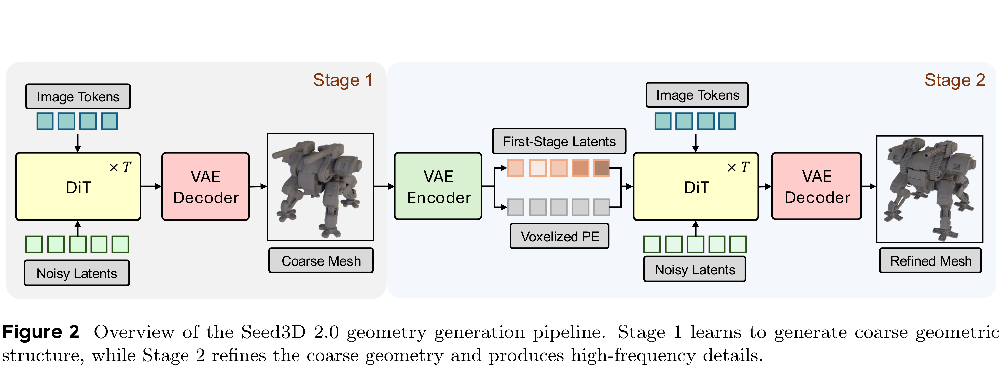

# Seed3D 2.0: Advancing High-Fidelity Simulation-Ready 3D Content Generation

[Official source](https://seed.bytedance.com/en/seed3d_2_0)

## Abstract

We present Seed3D 2.0, an advanced 3D content generation system built on Seed3D 1.0 [16], with substantial improvements across generation fidelity, simulation-ready capabilities, and application coverage. For geometry, a coarse-to-fine two-stage pipeline decouples global structure learning from high-frequency detail recovery, while a locality-aware VAE achieves higher spatial compression and more efficient decoding. For texture and material generation, we replace the cascaded pipeline of Seed3D 1.0 with a unified PBR model that directly generates multi-view albedo and metallic-roughness maps, enhanced by Mixture-of-Experts scaling and VLM-based semantic conditioning for improved material precision and visual fidelity. Beyond single-object generation, Seed3D 2.0 introduces a simulation-ready model suite comprising scene layout planning, part-aware decomposition, and training-free articulation generation, enabling coherent scene construction and part-level physical interaction across physics and graphics engines. A large-scale human preference study against five recent commercial models shows that Seed3D 2.0 achieves consistent win rates of 69.0% to 89.9% in textured 3D asset generation. Seed3D 2.0 is available at Volcano Enginea.

Figure 2 Overview of the Seed3D 2.0 geometry generation pipeline. Stage 1 learns to generate coarse geometric structure, while Stage 2 refines the coarse geometry and produces high-frequency details.

p. 4
