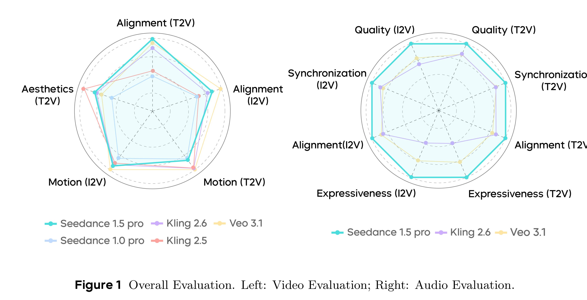

# Seedance 1.5 pro: A Native Audio-Visual Joint Generation Foundation Model

[Official source](https://seed.bytedance.com/en/blog/sound-and-vision-all-in-one-take-the-official-release-of-seedance-1-5-pro)

## Abstract

Recent strides in video generation have paved the way for unified audio-visual generation. In this work, we present Seedance 1.5 pro, a foundational model engineered specifically for native, joint audio-video generation. Leveraging a dual-branch Diffusion Transformer architecture, the model integrates a cross-modal joint module with a specialized multi-stage data pipeline, achieving exceptional audio-visual synchronization and superior generation quality. To ensure practical utility, we implement meticulous post-training optimizations, including Supervised Fine-Tuning (SFT) on high-quality datasets and Reinforcement Learning from Human Feedback (RLHF) with multi-dimensional reward models. Furthermore, we introduce an acceleration framework that boosts inference speed by over 10×. Seedance 1.5 pro distinguishes itself through precise multilingual and dialect lip-syncing, dynamic cinematic camera control, and enhanced narrative coherence, positioning it as a robust engine for professional-grade content creation. Seedance 1.5 pro is now accessible on Volcano Engineα.

Figure 1 Overall Evaluation. Left: Video Evaluation; Right: Audio Evaluation.

p. 1
