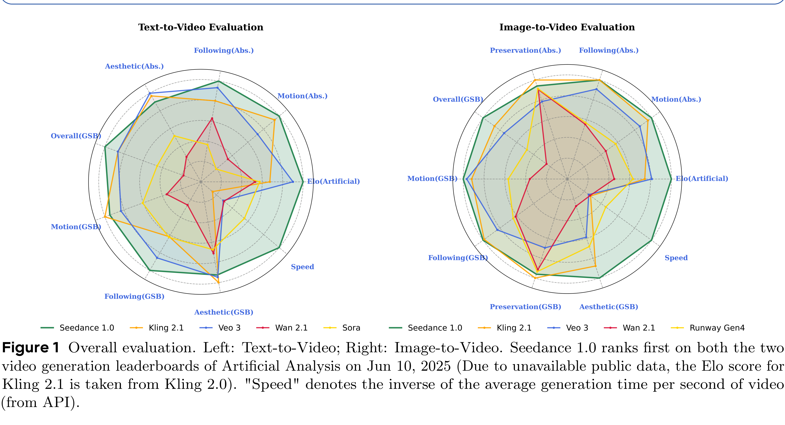

# Seedance 1.0: Exploring the Boundaries of Video Generation Models

[Official source](https://arxiv.org/abs/2506.09113)

## Abstract

Notable breakthroughs in diffusion modeling have propelled rapid improvements in video generation, yet current foundational model still face critical challenges in simultaneously balancing prompt following, motion plausibility, and visual quality. In this report, we introduce Seedance 1.0, a high-performance and inference-efficient video foundation generation model that integrates several core technical improvements: (i) multi-source data curation augmented with precision and meaningful video captioning, enabling comprehensive learning across diverse scenarios; (ii) an efficient architecture design with proposed training paradigm, which allows for natively supporting multi-shot generation and jointly learning of both text-to-video and image-to-video tasks. (iii) carefully-optimized post-training approaches leveraging fine-grained supervised fine-tuning, and video-specific RLHF with multi-dimensional reward mechanisms for comprehensive performance improvements; (iv) excellent model acceleration achieving 10× inference speedup through multi-stage distillation strategies and system-level optimizations. Seedance 1.0 can generate a 5-second video at 1080p resolution only with 41.4 seconds (NVIDIA-L20). Compared to state-of-the-art video generation models, Seedance 1.0 stands out with high-quality and fast video generation having superior spatiotemporal fluidity with structural stability, precise instruction adherence in complex multi-subject contexts, native multi-shot narrative coherence with consistent subject representation. Seedance 1.0 is now accessible on Volcano Engineα.

Figure 1 Overall evaluation. Left: Text-to-Video; Right: Image-to-Video. Seedance 1.0 ranks first on both the two video generation leaderboards of Artificial Analysis on Jun 10, 2025 (Due to unavailable public data, the Elo score for Kling 2.1 is taken from Kling 2.0). "Speed" denotes the inverse of the average generation time per second of video (from API).

Figure 1 Overall evaluation. Left: Text-to-Video; Right: Image-to-Video. Seedance 1.0 ranks first on both the two video generation leaderboards of Artificial Analysis on Jun 10, 2025 (Due to unavailable public data, the Elo score for Kling 2.1 is taken from Kling 2.0). "Speed" denotes the inverse of the average generation time per second of video (from API).

p. 1
