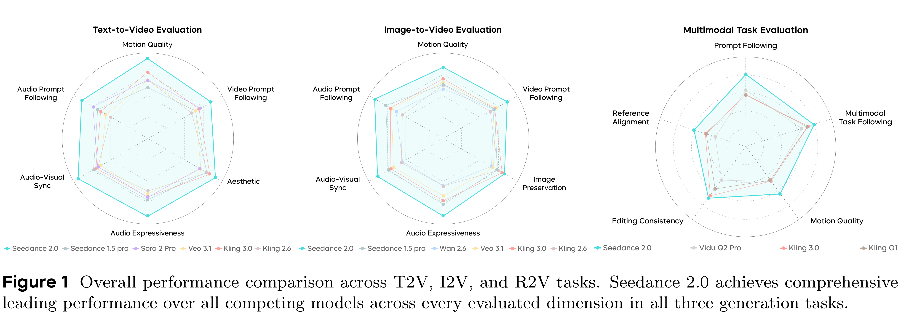

# Seedance 2.0: Advancing Video Generation for World Complexity

[Official source](https://seed.bytedance.com/en/research)

## 2.1 Overview

To objectively and comprehensively assess the overall capabilities of Seedance 2.0 in multi-modal scenarios, our team collaborated with experts from the media industry to establish a comprehensive evaluation benchmark and corresponding evaluation protocols. The benchmark covers audio-video generation, reference-based generation, and video editing scenarios. This evaluation focuses on the model’s performance across core dimensions: multi-modal reference-based generation, complex audio-video instruction following, complex motion stability, professional cinematographic language expression, audio and video expressiveness, and audio-visual integrated alignment. As shown in Figure 1, Seedance 2.0 achieves the highest scores across all evaluated dimensions in Text-to-Video (T2V), Image-to-Video (I2V), and Reference-to-Video (R2V) tasks, demonstrating comprehensive leading performance over current competing models.

Text-to-Video and Image-to-Video Evaluation. In video generation tasks, Seedance 2.0 delivers competitive leading performance in the industry. Marked improvements have been achieved in motion stability, instruction following capability, and visual aesthetics. The model effectively mitigates common structural inaccuracies and visual artifacts, generating smooth and nuanced complex motions. It can accurately render high-tension large-scale movements and subtle micro-expressions, while supporting professional-level combined camera movements and narrative rhythm control. For long scripts and open-ended instructions, the model can respond appropriately and deliver reasonable generation outputs. Meanwhile, the generated videos exhibit notable cinematic aesthetics, with well-rendered object textures, lighting and composition, as well as costume, makeup and prop design. In the audio domain, Seedance 2.0 maintains strong performance with substantial improvements in audio expressiveness. Its dual-channel audio output presents rich and nuanced layers, and can generate sound effects or melodies that align well with the context described in the prompts. Compared with the previous version, the model delivers an enhanced audio-visual integrated experience, with tighter alignment between dialogue lines, sound effects, background audio, and visual content. Meanwhile, the

instruction following accuracy for Chinese dialects, traditional opera, and singing scenarios is significantly improved.

Multi-modal Reference-Based Generation Evaluation. Seedance 2.0 achieves competitive leading comprehensive performance in reference-based generation tasks. The model supports a more comprehensive range of reference-based tasks, covering multiple creative scenarios including multi-modal reference-based generation, video editing, and video continuation. Meanwhile, it demonstrates advantages in the depth of understanding and response accuracy for reference content. Specifically, in video editing tasks, Seedance 2.0 delivers more complete instruction following and more photorealistic visual outputs compared with peer models. In terms of generation consistency, the model achieves favorable performance in subject appearance and voice restoration, with particularly notable advantages in maintaining reference consistency for action logic, special effect styles, and plot narrative. Despite these strengths, there is still room for optimization in multi-subject consistency, text restoration accuracy, and the performance of complex editing tasks.

We evaluate Seedance 2.0 on three generation tasks—T2V (Text-to-Video), I2V (Image-to-Video), and R2V (Reference-to-Video)—against current commercial video generation models. Seedance 2.0 ranks first across all video and audio dimensions on every task.

On video, the main advances are: (1) Stability—fewer deformations and structural issues; complex actions are fluid; multilingual text generation and preservation are relatively strong. (2) Vividness—sports, combat, and other high-amplitude actions carry strong momentum; facial expressions and gaze are emotionally engaging; the model produces professional-level camera movements, dynamic editing, and narrative pacing. (3) Instruction following—long-script prompts are executed with reasonable precision, multi-shot and multi-angle instructions are followed accurately, and open-ended prompts receive appropriate creative interpretation; multiple art styles are supported; in I2V, special art styles from the reference image are preserved while adapting subject motion to match. (4) Visual realism—object materials look authentic, lighting, composition, and character texture improve notably, and costume and prop design is polished.

On audio: (1) Expressiveness—audio is detailed and layered, with dual-channel support; melodies and tones match the prompt context, and the audio dimension adds to the emotional impact of the video. (2) Audio-visual sync—lip movements match the visual, dialogue, sound effects, and background audio align well, and beat-matching between audio and video is strong. (3) Audio instruction following—Chinese dialects (Sichuan, Northeastern, Cantonese), opera, and singing improve markedly over the previous version; singing, rap, and instrumental performance are consistent, with melodies adapted to the prompt context.

Areas for improvement remain: minor deformation artifacts, motion plausibility in edge cases, high-frequency visual noise, audio distortion and noise, and lip-sync errors in multi-speaker scenes. The following subsections present detailed results for each task.

Figure 1 Overall performance comparison across T2V, I2V, and R2V tasks. Seedance 2.0 achieves comprehensive leading performance over all competing models across every evaluated dimension in all three generation tasks.

p. 3
