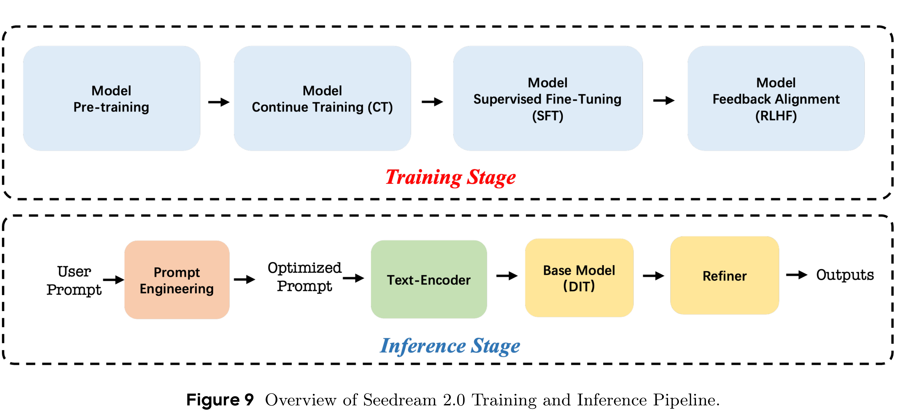

# Seedream 2.0: A Native Chinese-English Bilingual Image Generation Foundation Model

[Official source](https://seed.bytedance.com/en/blog/doubao-text-to-image-technical-report-released-full-disclosure-of-data-processing-pre-training-and-rlhf-workflow)

## Abstract

Rapid advancement of diffusion models has catalyzed remarkable progress in the field of image generation. However, prevalent models such as Flux, SD3.5 and Midjourney, still grapple with issues like model bias, limited text rendering capabilities, and insufficient understanding of Chinese cultural nuances. To address these limitations, we present Seedream 2.0, a native Chinese-English bilingual image generation foundation model that excels across diverse dimensions, which adeptly manages text prompt in both Chinese and English, supporting bilingual image generation and text rendering. We develop a powerful data system that facilitates knowledge integration, and a caption system that balances the accuracy and richness for image description. Particularly, Seedream is integrated with a self-developed bilingual large language model (LLM) as a text encode, allowing it to learn native knowledge directly from massive data. This enable it to generate high-fidelity images with accurate cultural nuances and aesthetic expressions described in either Chinese or English. Beside, Glyph-Aligned ByT5 is applied for flexible character-level text rendering, while a Scaled ROPE generalizes well to untrained resolutions. Multi-phase post-training optimizations, including SFT and RLHF iterations, further improve the overall capability. Through extensive experimentation, we demonstrate that Seedream 2.0 achieves state-of-the-art performance across multiple aspects, including prompt-following, aesthetics, text rendering, and structural correctness. Furthermore, Seedream 2.0 has been optimized through multiple RLHF iterations to closely align its output with human preferences, as revealed by its outstanding ELO score. In addition, it can be readily adapted to an instruction-based image editing model, such as SeedEdit [28], with strong editing capability that balances instruction-following and image consistency.

Figure 9 Overview of Seedream 2.0 Training and Inference Pipeline.

p. 8
