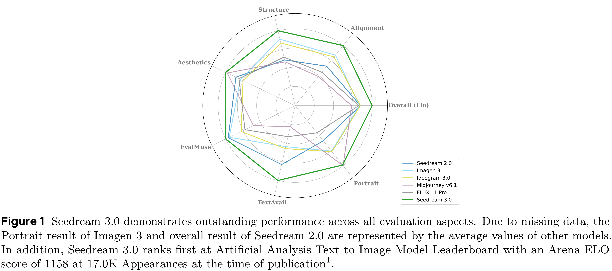

# Seedream 3.0 Technical Report

[Official source](https://arxiv.org/abs/2504.11346)

## Abstract

We present Seedream 3.0, a high-performance Chinese-English bilingual image generation foundation model. We develop several technical improvements to address existing challenges in Seedream 2.0, including alignment with complicated prompts, fine-grained typography generation, suboptimal visual aesthetics and fidelity, and limited image resolutions. Specifically, the advancements of Seedream 3.0 stem from improvements across the entire pipeline, from data construction to model deployment. At the data stratum, we double the dataset using a defect-aware training paradigm and a dual-axis collaborative data-sampling framework. Furthermore, we adopt several effective techniques such as mixed-resolution training, cross-modality RoPE, representation alignment loss, and resolution-aware timestep sampling in the pre-training phase. During the post-training stage, we utilize diversified aesthetic captions in SFT, and a VLM-based reward model with scaling, thereby achieving outputs that well align with human preferences. Furthermore, Seedream 3.0 pioneers a novel acceleration paradigm. By employing consistent noise expectation and importance-aware timestep sampling, we achieve a 4 to 8 times speedup while maintaining image quality. Seedream 3.0 demonstrates significant improvements over Seedream 2.0: it enhances overall capabilities, in particular for text-rendering in complicated Chinese characters which is important to professional typography generation. In addition, it provides native high-resolution output (up to 2K), allowing it to generate images with high visual quality. Seedream 3.0 is now accessible on Volcano Engineα.

Figure 1 Seedream 3.0 demonstrates outstanding performance across all evaluation aspects. Due to missing data, the Portrait result of Imagen 3 and overall result of Seedream 2.0 are represented by the average values of other models. In addition, Seedream 3.0 ranks first at Artificial Analysis Text to Image Model Leaderboard with an Arena ELO score of 1158 at 17.0K Appearances at the time of publication1.

p. 1
