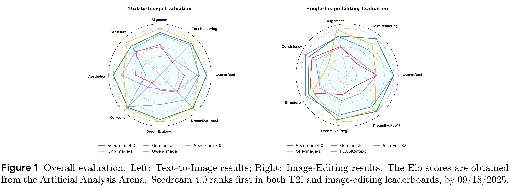

# Seedream 4.0: Toward Next-generation Multimodal Image Generation

[Official source](https://arxiv.org/abs/2509.20427)

## Abstract

We introduce Seedream 4.0, an efficient and high-performance multimodal image generation system that unifies text-to-image (T2I) synthesis, image editing, and multi-image composition within a single framework. We develop a highly efficient diffusion transformer with a powerful VAE which also can reduce the number of image tokens considerably. This allows for efficient training of our model, and enables it to fast generate native high-resolution images (e.g., 1K-4K). Seedream 4.0 is pretrained on billions of text–image pairs spanning diverse taxonomies and knowledge-centric concepts. Comprehensive data collection across hundreds of vertical scenarios, coupled with optimized strategies, ensures stable and large-scale training, with strong generalization. By incorporating a carefully fine-tuned VLM model, we perform multi-modal post-training for training both T2I and image editing tasks jointly. For inference acceleration, we integrate adversarial distillation, distribution matching, and quantization, as well as speculative decoding. It achieves an inference time of up to 1.4 seconds for generating a 2K image (without a LLM/VLM as PE model). Comprehensive evaluations reveal that Seedream 4.0 can achieve state-of-the-art results on both T2I and multimodal image editing. In particular, it demonstrates exceptional multimodal capabilities in complex tasks, including precise image editing and in-context reasoning, and also allows for multi-image reference, and can generate multiple output images. This extends traditional T2I systems into an more interactive and multidimensional creative tool, pushing the boundary of generative AI for both creativity and professional applications. We further scale our model and data as Seedream 4.5, which consistently outperforms Seedream 4.0 in both T2I and image editing tasks. Seedream 4.0 and Seedream 4.5 are accessible on Volcano Engineα.

Figure 1 Overall evaluation. Left: Text-to-Image results; Right: Image-Editing results. The Elo scores are obtained from the Artificial Analysis Arena. Seedream 4.0 ranks first in both T2I and image-editing leaderboards, by 09/18/2025.

p. 1
