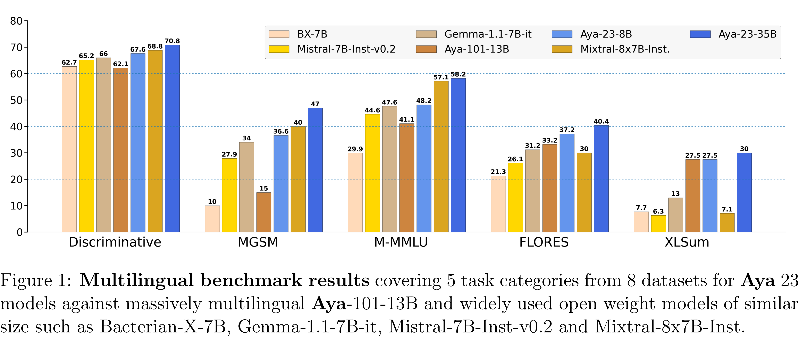

# Aya 23: Open Weight Releases to Further Multilingual Progress

[Official source](https://cohere.com/research/aya)

## Abstract

This technical report introduces Aya 23, a family of multilingual language models. Aya 23 builds on the recent release of the Aya model [Üstün et al., 2024], focusing on pairing a highly performant pre-trained model with the recently released Aya collection [Singh et al., 2024]. The result is a powerful multilingual large language model serving 23 languages, expanding state-of-art language modeling capabilities to approximately half of the world’s population. The Aya model covered 101 languages whereas Aya 23 is an experiment in depth vs breadth, exploring the impact of allocating more capacity to fewer languages that are included during pre-training. Aya 23 outperforms both previous massively multilingual models like Aya 101 for the languages it covers, as well as widely used models like Gemma, Mistral and Mixtral on an extensive range of discriminative and generative tasks. We release the open weights for both the 8B and 35B models as part of our continued commitment for expanding access to multilingual progress.

Aya-23-8B: https://huggingface.co/CohereForAI/aya-23-8B Aya-23-35B: https://huggingface.co/CohereForAI/aya-23-35B

Figure 1: Multilingual benchmark results covering 5 task categories from 8 datasets for Aya 23 models against massively multilingual Aya-101-13B and widely used open weight models of similar size such as Bacterian-X-7B, Gemma-1.1-7B-it, Mistral-7B-Inst-v0.2 and Mixtral-8x7B-Inst.

p. 2
