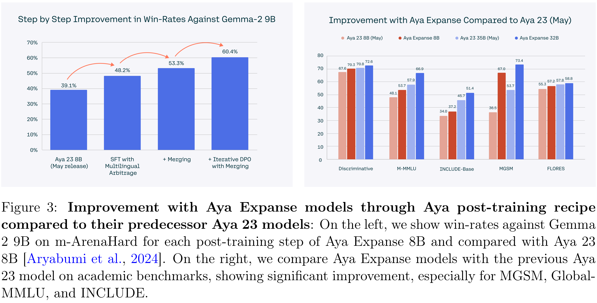

# Aya Expanse: Combining Research Breakthroughs for a New Multilingual Frontier

[Official source](https://cohere.com/research/aya)

## Abstract

We introduce the Aya Expanse model family, a new generation of 8B and 32B parameter multilingual language models, aiming to address the critical challenge of developing highly performant multilingual models that match or surpass the capabilities of monolingual models. By leveraging several years of research at Cohere For AI and Cohere, including advancements in data arbitrage, multilingual preference training, and model merging, Aya Expanse sets a new state-of-the-art in multilingual performance. Our evaluations on the Arena-Hard-Auto dataset, translated into 23 languages, demonstrate that Aya Expanse 8B and 32B outperform leading open-weight models in their respective parameter classes, including Gemma 2, Qwen 2.5, and Llama 3.1, achieving up to a 76.6% win-rate. Notably, Aya Expanse 32B outperforms Llama 3.1 70B, a model with twice as many parameters, achieving a 54.0% win-rate. In this short technical report, we present extended evaluation results for the Aya Expanse model family and release their open-weights, together with a new multilingual evaluation dataset m-ArenaHard.

Aya Expanse 8B: https://hf.co/CohereForAI/aya-expanse-8b Aya Expanse 32B: https://hf.co/CohereForAI/aya-expanse-32b

m-ArenaHard Dataset: https://hf.co/datasets/CohereForAI/m-ArenaHard

Released as a preprint on December 6, 2024

Figure 3: Improvement with Aya Expanse models through Aya post-training recipe compared to their predecessor Aya 23 models: On the left, we show win-rates against Gemma 2 9B on m-ArenaHard for each post-training step of Aya Expanse 8B and compared with Aya 23 8B [Aryabumi et al., 2024]. On the right, we compare Aya Expanse models with the previous Aya 23 model on academic benchmarks, showing significant improvement, especially for MGSM, Global-MMLU, and INCLUDE.

p. 9
