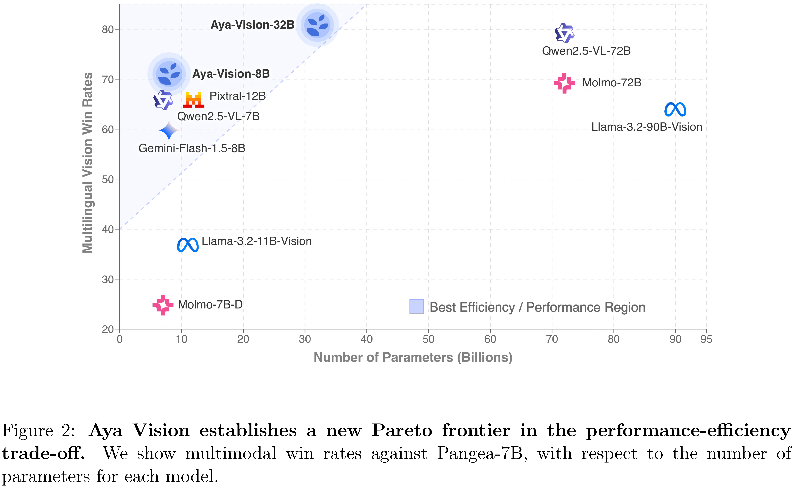

# Aya Vision: Advancing the Frontier of Multilingual Multimodality

[Official source](https://cohere.com/research/aya)

## Abstract

Building multimodal language models is fundamentally challenging: it requires aligning vision and language modalities, curating high-quality instruction data, and avoiding the degradation of existing text-only capabilities once vision is introduced. These difficulties are further magnified in the multilingual setting, where the need for multimodal data in different languages exacerbates existing data scarcity, machine translation often distorts meaning, and catastrophic forgetting is more pronounced. To address the aforementioned challenges, we introduce novel techniques spanning both data and modeling. First, we develop a synthetic annotation framework that curates high-quality, diverse multilingual multimodal instruction data, enabling Aya Vision models to produce natural, human-preferred responses to multimodal inputs across many languages. Complementing this, we propose a cross-modal model merging technique that mitigates catastrophic forgetting, effectively preserving text-only capabilities while simultaneously enhancing multimodal generative performance. Aya-Vision-8B achieves best-in-class performance compared to strong multimodal models such as Qwen-2.5-VL-7B, Pixtral-12B, and even much larger Llama-3.2-90B-Vision. We further scale this approach with Aya-Vision-32B, which outperforms models more than twice its size, such as Molmo-72B and LLaMA-3.2-90B-Vision. Our work advances multilingual progress on the multi-modal frontier, and provides insights into techniques that effectively bend the need for compute while delivering extremely high performance. Aya-Vision-8B: https://huggingface.co/CohereLabs/aya-vision-8B Aya-Vision-32B: https://huggingface.co/CohereLabs/aya-vision-32B AyaVisionBench: https://huggingface.co/datasets/CohereLabs/AyaVisionBench

Released as a preprint on May 14, 2025

Figure 2: Aya Vision establishes a new Pareto frontier in the performance-efficiency trade-off. We show multimodal win rates against Pangea-7B, with respect to the number of parameters for each model.

p. 4
