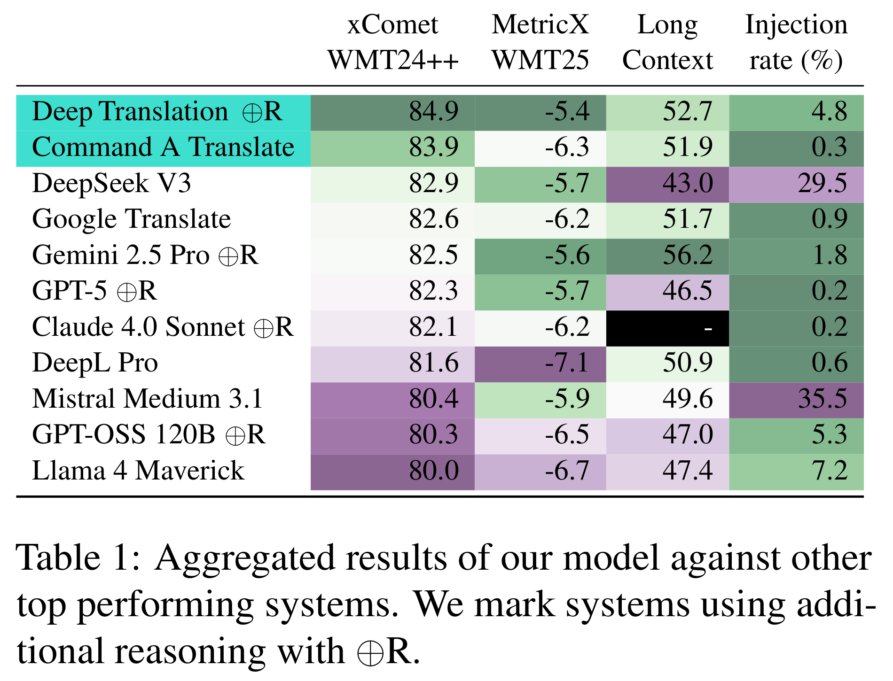

# Command-A-Translate: Raising the Bar of Machine Translation with Difficulty Filtering

[Official source](https://aclanthology.org/2025.wmt-1.55/)

## Abstract

We present Command A Translate, an LLM-based machine translation model built off Cohere’s Command A. It reaches state-of-the-art machine translation quality via direct preference optimization. Our meticulously designed data preparation pipeline emphasizes robust quality control and a novel difficulty filtering – a key innovation that distinguishes Command A Translate. Furthermore, we extend our model and participate at WMT with a system (CommandA-WMT) that uses two models and post-editing steps of step-by-step reasoning and limited Minimum Bayes Risk decoding.

Table 1: Aggregated results of our model against other top performing systems. We mark systems using additional reasoning with ⊕R.

p. 1
